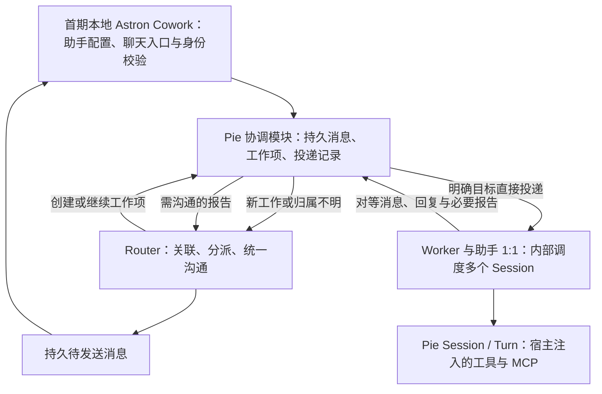

# DeepSeek Super-agent 与 Pie 演进评估

核验日期：2026-11-04。状态：调研完成，以下实施路线为建议，尚未实现或验收。

具体方案以 [助手 Worker 与持久协调 SPEC（待审阅）](specs/super-agent-coordination.md) 为准。2026-11-05 的讨论确定：Cowork assistant 与逻辑 Worker 1:1，Worker 内部调度多个 Session；新协调路径以对等消息替代 task，Router 有增量再推理、无增量才提交方案。先实现本地 Astron + Pie，再推进端云协同。以下来源核验仍对应 2026-11-04 的调研；上述映射与通信方式是 Pie 的设计选择，不代表 DeepSeek 原型已经实现。

## 来源与边界

- 用户提供的[微信原文](https://mp.weixin.qq.com/s/zoS7GlReWPhfCjENGxXCdg)返回访问验证，另一个知乎入口也无法直接读取。通过[标注转载原文的页面](https://blog2.eimoon.com/p/deepseek-super-agent-design/)阅读文章结构；它不是官方站点，也没有逐字校验转载与原稿的一致性。
- 技术判断以 DeepSeek 官方 [dsh-superagent-prototype](https://github.com/deepseek-ai/dsh-superagent-prototype/tree/8c32a9dc5d72c033816c6a8110b37f40cf94fba4) 的文档与源码为依据，固定提交为 `8c32a9dc5d72c033816c6a8110b37f40cf94fba4`。官方明确这是研究原型，文章中的设计没有全部实现。[原型范围](https://github.com/deepseek-ai/dsh-superagent-prototype/blob/8c32a9dc5d72c033816c6a8110b37f40cf94fba4/README.md)
- Pie 对照当前工作树，HEAD 为 `ad967e71e5648171fc0803bb6fb3ad9119aea2cd`，包含其他会话已有的未提交改动；源码能力不等于已构建、部署或通过生产验收。调研后按用户要求单独修复了 [Turn 所属后台作业取消](specs/background-job-cancellation.md)，协调层仍未实现。

## 核心判断

同意 Pie 向这个方向演进。最先要解决的是用户在多个入口持续推进同一项工作时，不再手动搬运上下文、挑选 Session 和跟踪执行状态。

例如：IM 提出修复需求，系统创建工作项与执行会话；随后 PR 评论改了要求，CI 又报告失败。这些后续事件应找到原工作项，送回原执行者；用户同时提出另一件事时，另开执行会话并行推进。对外的沟通仍保持统一。

因此，首要缺口是持久任务协调。递归 Subagent、任务依赖图、自动模型路由可以后置，不应把它们当作这篇设计的起点。官方原型的核心领域也是 Source、Trigger、Thread、Ticket、Assignment 和 Subscription，执行器通过接口连接，独立于工作项领域。[领域模型](https://github.com/deepseek-ai/dsh-superagent-prototype/blob/8c32a9dc5d72c033816c6a8110b37f40cf94fba4/docs/001-domain.md)

## 设计中值得采用的机制

| 机制 | 对 Pie 的启示 |
| --- | --- |
| Router / Worker 分工 | 将工作关联与具体执行分开，避免长任务堵住入口；Pie 的助手、Worker、Session 关系按下文落地 |
| 事件过滤与订阅直通 | 确定性规则先过滤；新工作交给 Router；已知讨论的后续消息直接投递给订阅者 |
| 按引用读取上下文 | 当前输入只带必要正文、摘要与关联 ID；需要时沿事件、讨论、工作项和会话逐步读取 |
| 异步执行与分渠道输出 | 启动任务后前台继续接收输入；工作报告与对外消息分开，常规进度不必打扰用户 |
| 持久化与外部监督 | 先保存工作事实再执行；重启后核对已有结果；独立于执行实例检查故障与任务进展 |

订阅直通与对象关联见[领域模型](https://github.com/deepseek-ai/dsh-superagent-prototype/blob/8c32a9dc5d72c033816c6a8110b37f40cf94fba4/docs/001-domain.md)；上下文读取、消息注入和工具接口见[架构文档](https://github.com/deepseek-ai/dsh-superagent-prototype/blob/8c32a9dc5d72c033816c6a8110b37f40cf94fba4/docs/007-architecture.md)。

要保留两个实施边界：公开原型是一份 SQLite 加单进程锁，不能据此宣称已经实现跨主机无状态调度；部署指南中的 Watchdog 是另一个 DSH profile 定时检查服务，并非已内置完整的任务自愈服务。[持久化实现](https://github.com/deepseek-ai/dsh-superagent-prototype/blob/8c32a9dc5d72c033816c6a8110b37f40cf94fba4/src/app/runtime.ts#L100)、[外部检查部署](https://github.com/deepseek-ai/dsh-superagent-prototype/blob/8c32a9dc5d72c033816c6a8110b37f40cf94fba4/docs/006-deployment.md#L133)

## Pie 已有什么、还缺什么

| 能力 | 当前源码与边界 | 下一步缺口 |
| --- | --- | --- |
| 多会话执行 | 不同 Session 可并发；`task(background: true)` 也可启动多个同时运行的子助手。前台 `task` 则按串行工具执行。[Agent 工厂](../packages/runtime/src/agent.ts)、[执行实现](../packages/runtime/src/runtime.ts) | 工作项调度、并发配额和人类消息优先级 |
| 不同角色使用不同模型 | Subagent binding 已可指定模型；根会话也有模型覆写。[配置](../packages/runtime/src/config.ts)、[执行实现](../packages/runtime/src/runtime.ts) | 自动选择与跨任务预算，不是从零增加多模型 |
| 异步工具与通知 | 后台 Shell、Task、`job_output/job_kill`、完成通知和 Steer 已存在。[工具与运行文档](agent-development.md)、[后台观察 SPEC](specs/background-work-observation.md) | 外部事件的持久收件箱、消费确认和重新投递 |
| 状态与计算分离 | RuntimeStore 注入、工作窗口读取和按需重建已有实现；默认 `retain`，启用 `release-after-turn` 后按条件卸载。[嵌入文档](runtime-embedding.md) | 协调层与执行层的跨实例归属、共享状态和故障接管联合验收 |
| 执行恢复 | ToolExecution 账本与 DurableJob 支持保存关联、查询原任务、提交确定结果后恢复。[恢复 SPEC](specs/turn-recovery.md)、[外部任务 SPEC](specs/durable-jobs.md) | Subagent 级联恢复、内存 Job 和未消费队列仍不支持接管 |
| 上下文与能力发现 | 消息树、压缩窗口、历史分页、Skill/MCP/工具发现已有实现。[运行文档](agent-development.md) | 外部事件、讨论与工作项之间的可授权查询关系 |
| 运行观察 | Turn 事件、执行投影和本实例作业查询已有实现。[事件 SPEC](specs/session-event-stream.md)、[后台观察 SPEC](specs/background-work-observation.md) | 跨 Turn 的工作项状态、待人工决策和完整派工记录 |

特别注意当前三个事实：

1. `runSubagent` 强制子配置没有 Subagent；新子会话不复制父完整历史，只接收派发 prompt。这个限制不阻止先做多工作项调度。
2. 取消活跃 Turn 会停止该 Turn 所属前后台 Task、Shell 及子任务遗留 Shell；正常完成保留后台工作，取消新 Turn 不影响旧 Turn 的作业。目标助手的独立根 Session 仍需分别控制，不能宣称停止 Router 就停止全部工作。
3. SSE 是运行观察流，Steer 的排队受理也不是跨重启可靠消息队列；已有 canonical/request 身份不能替代跨 Turn 的持久事件去重表。

以上以 [Runtime 源码](../packages/runtime/src/runtime.ts)、[嵌入契约](runtime-embedding.md)、[固定目标取消 SPEC](specs/targeted-cancellation.md)和[后台作业取消 SPEC](specs/background-job-cancellation.md)为准。

## 建议分层

共享协调层属于 Pie 的可复用能力，但位于现有 Session/Turn 执行语义之上。先通过 Runtime SDK 验证这个边界，再决定是否拆包，不先建设通用分布式工作流平台。

- **Pie 执行内核**继续拥有 Session、Turn、工具账本、上下文、权限交互与恢复；Router 和 Worker 都复用现有 Agent Loop。
- **共享协调模块**拥有助手到 Worker 的映射、Worker 内部会话调度，以及跨 Turn 的工作项、事件订阅、消息、投递与结果状态。一个工作项可由多个助手的 Session 协作，不能直接用 `Turn.status` 表示。
- **产品宿主**继续拥有渠道接入、来源身份与权限策略、产品助手配置、产品展示和工具环境；Pie 不接管账号、市场资产或具体平台 API。[现有宿主边界](runtime-embedding.md)

本地首期复用 Cowork assistant 身份作为逻辑 Worker，一个 Worker 管理多个独立根 Session；合同甲、乙使用同一合同助手的不同 Session，可并行推进。新模式由 send_message / wait_message 表达请求、追问、回复和等待，不继续使用 task 父子委派。消息按原请求或明确会话关联送入目标上下文，投递与唤醒不依赖 Router 模型；新工作 Session 使用目标助手配置和宿主选择的目录，不继承发送者的完整历史或审批记忆。

协调模块保存工作项、Worker、Session 与请求的关联，桥接人工交互和停止范围。通信不转移执行归属或取消权，停止一个工作不关闭整个助手，也不影响它的其他 Session。旧普通聊天、群聊及历史 Subagent 路径过渡保留；新协调模式另行启用，不自动迁移旧历史。端云投递与多实例接管在本地链路验收后单独实施。

授权必须随工作项固定范围。订阅取得的是上下文，不能因 CI 输出、文档或群聊消息中的文字而扩大工具权限；不同来源身份的认证与映射仍由可信宿主处理。DeepSeek 也将 Mandate 与 Subscription 分开。[授权设计](https://github.com/deepseek-ai/dsh-superagent-prototype/blob/8c32a9dc5d72c033816c6a8110b37f40cf94fba4/docs/002-authorization.md)

## 分步演进顺序

实施顺序统一维护在 [设计 SPEC 的分步路线](specs/super-agent-coordination.md#分步演进路线)，每步包含交付与验收：

1. 补齐本地幂等创建、持久输入收据/批次接纳、等待让出和宿主停止能力。
2. 接通 assistant = Worker 的身份映射、内部多 Session 调度与 Astron 产品绑定。
3. 新路径以对等通信替代 task，支持请求、追问、回复、等待与唤醒。
4. Router 持续收件，有增量再推理，无增量才提交最终消息与派工动作。
5. 验收本地 Astron + Pie 的聊天、消息、权限、工作项停止和结果产物完整闭环，以及两个本地来源替身。
6. 完成本地重启对账，只恢复符合安全条件的执行，未知副作用保留核对状态。
7. 本地验收后再扩展端云协同、远端适配、多实例归属与旧执行者隔离、预算和监督。

第 1～5 步交付首个本地可用版本，未启用新模式的普通聊天继续原路径。第 6 步之前不承诺自动续跑；端云、多实例隔离与设备离线/重连必须在第 7 步单独验收。持续来信时 Router 追读上限仍待决定。实现验收使用 faux 模型和本地替身，SDK 测试之外仍须完成本地 Cowork 产品链路验收。

## 本次未做与风险

Super-agent 仅交付调研与设计，没有实现协调代码、真实渠道接入或性能实验，也没有构建或部署。独立取消修复的代码与回归结果记录在 [后台作业取消 SPEC](specs/background-job-cancellation.md)，不代表协调设计已经验收。

暂不引入无限递归、通用任务 DAG、Router 分片或全量历史共享；获准 Worker 的点对点通信纳入首阶段。现有执行目录与权限确认不是进程沙箱，重启也不能证明旧外部副作用已停止；这些边界在主动跨渠道、跨设备执行时必须保留。DeepSeek 原型同样明确其目录和命令包装不构成安全隔离。[原型执行边界](https://github.com/deepseek-ai/dsh-superagent-prototype/blob/8c32a9dc5d72c033816c6a8110b37f40cf94fba4/docs/003-execution.md)
