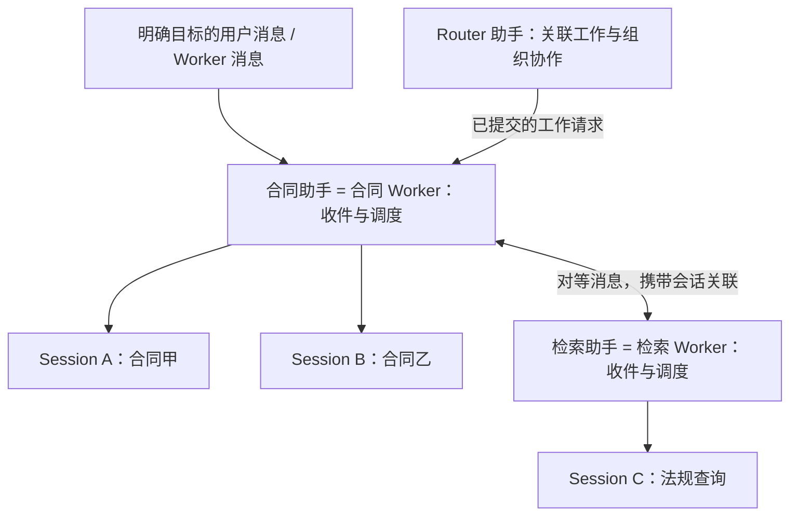
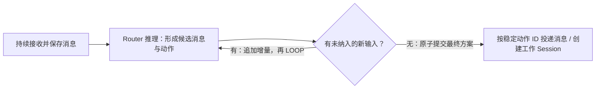

# Pie 助手 Worker 与持久协调设计

状态：第 2 步 Assistant = Worker 与内部调度（Pie 侧）已完成；后续步骤未实施，Astron 产品联调待内网。更新：2026-11-05。

已获准按步骤实施并汇报进度。首期在本地 Astron Cowork + Pie 实现，端云协同在本地链路验收后推进。前置来源见 [DeepSeek Super-agent 评估](../deepseek-super-agent-assessment.md)；下述助手与 Worker 的对应关系是本次 Pie 讨论确定的模型，不代表 DeepSeek 原型的实现。

## 问题与目标

现有 `task` 将助手协作表达为父 Session 调用子 Session，再等待或接收结果。目标改为：长期助手之间平等通信，每个助手管理自己的多个工作会话；新工作、补充、追问和回复都能持续进入正确上下文。

例如：合同助手同时审合同甲、乙，分别使用 Session A、B。A 向检索助手请求法规，检索助手在 Session C 处理、追问并回复 A；B 同时继续执行，整个往返不需要 Router 转述。

保留现有聊天、模型、工具、Skill、MCP、权限、压缩、历史、产物与停止能力。新协调模式以消息协作替代 `task`；旧路径只承担过渡兼容，不作为新架构的调用协议。

## 确定的领域关系

| 对象 | 含义与关系 |
| --- | --- |
| Cowork assistant / Pie Worker | 同一长期助手身份在产品层与执行层的表达；同一宿主授权域内 1:1，可复用 assistantId 作为逻辑 workerId |
| Worker 内部调度 | 接收消息、确定所属 Session、安排执行、维护等待与唤醒；不承载所有工作的共同聊天历史 |
| Session | Worker 处理某项工作的独立上下文；一个 Worker 可有多个 Session，首期一个工作 Session 只关联一个工作项 |
| Turn | Session 内的一轮模型与工具执行；一个 Session 可经历多个 Turn，等待回复后可以新 Turn 继续 |
| WorkItem，工作项 | 业务目标、授权范围与结果；可关联多个助手的工作 Session，不独占任何一个 Worker |
| Router | 一种助手角色，同样由 Worker 和 Session 承载；负责接单与跨助手协调，不是消息传输的必经节点 |

Worker 是逻辑身份，不等于常驻进程或单个 Agent 实例。空闲 Session 可以按现有策略释放 Agent，后续加载自己的历史。某个工作结束不关闭整个助手。

不同 Worker 可以并行；同一 Worker 的不同 Session 也可以并行，受宿主总并发与助手配额限制。同一 Session 的模型调用和 Turn 准入保持串行，不能用一个 Worker 全局执行锁阻塞所有工作。

## 首期范围与本地分层

首期使用本地 Astron 产品态和本地 Pie HTTP/SSE，复用现有助手管理、会话绑定与聊天展示。先验收本机完整链路，再扩展远端执行、共享存储与执行接管；首期不新增云服务、消息中间件、跨设备协议或 Web UI。

| 位置 | 本次职责 |
| --- | --- |
| Astron 宿主 | 提供账号与授权域、assistant 配置与可协作目标、默认工作目录、产品会话绑定、用户交互、状态与结果展示；拥有 Pie 进程和实际工具环境 |
| Pie 协调模块 | Worker 身份映射、持久收件、工作项与 Session 关联、Worker 内部调度、通信与等待、Router 决策、停止意图和对账 |
| Pie Runtime | Session / Turn、模型与工具执行、历史与压缩、权限交互、输入接纳与执行收据、安全恢复 |
| Pie Local / Server | Local 实现 SQLite 存储与本地能力；Server 负责本地装配、必要控制接口及 HTTP/SSE 转换，不放产品业务决策 |

计划以 `packages/runtime/src/coordination.ts` 提供可选 SDK 入口，复用已有 Agent Loop，不先拆新包或启动独立调度进程。Runtime、存储和能力由宿主注入；协调模块不导入 Local，不关闭共享 Runtime/MCP 等资源。

Astron 当前相关入口位于 `E:\Projects\cowork3\engine\servers\astronverse-agent\src\astronverse\agent`：`adapters/pie/runtime_config.py` 将助手投影到 `/host-runtimes`，同目录的 `transport.py` 创建绑定 assistantId 的 Pie Session，`runtime/services/session_service.py` 与 `store/session_bindings.py` 保存产品会话归属。实施时从这些既有入口接入，不建立另一套助手或插件注册表。

本轮只读对照 `/workspace/cowork3-ref/cowork3`：`cloud/tsconfig.pie.json` 直接检查共享 Runtime，`cloud/docs/assistant-config-refresh-validation.md` 约定 Session 固定助手身份、后续 Turn 采用最新注册修订，`cloud/apps/agent-service/src/server/session/session-record.ts` 保留产品会话及模型选择。Pie 据此从现有 `HostRuntimeDefinition.assistantId` 注册同 ID 的逻辑 Worker，不复制 Astron 助手/插件配置；目录、模型与 `productBinding` 由可信宿主为目标工作明确选择。参考树只读，Cowork 变更须在内网完成。

优先复用 Astron 当前管理的本地 Pie 实例，协调状态单独维护 schema。业务 Session 按所属助手进入现有产品绑定；内部 Router 协调 Session 由宿主明确标识和过滤，不污染普通会话列表。未启用新模式的 Session、群聊、事件流与旧 `task` 保持原路径，不自动迁移旧历史。

Agent Core 不识别业务工作项。新模式通过可选的会话工具与执行控制注入提供通信及让出能力；不把 `runSubagent` 改名后继续当作对等通信，也不通过 `parentSessionId` 表达协作关系。

## Worker 内部调度

收件与执行解耦。消息先保存到目标 Worker 的收件箱，再由内部调度关联 Session；确定性关联先执行，不为每条消息额外调用模型。

| 收到的输入 | 调度行为 |
| --- | --- |
| 明确的目标 Session | 核对 Worker、工作项和访问范围后投递原 Session |
| 带 reply_to 的追问或回复 | 根据原消息的可信往返关联定位 Session，不按助手最近聊天猜测 |
| 已有唯一工作关联的补充或请求 | 继续该 Worker 对应的工作 Session |
| 明确的新工作或新会话请求 | 持久记录创建意图，幂等创建该助手的根 Session，再保存绑定 |
| 无法唯一确定归属 | 保留待澄清，向来源返回需要的关联信息；模型辅助消歧不作为首期可靠投递的前提 |
| 目标 Session 繁忙、等待或已停止 | 繁忙时继续收件；等待时按条件唤醒；停止时保留明确结果，不自动重新启动 |

Session 使用目标助手的配置、宿主选择的模型与工作目录；不能隐式继承发送方的目录、完整历史或审批记忆。配置和 Skill 刷新沿用现有边界，不冻结为一份永远不更新的 Worker 副本。

每个目标 Session 按接收序号取批。模型/工具批次运行时继续收件，在下一模型调用间隙安全接纳；空闲时启动下一 Turn。工作即将结束时须重新检查待输入，并处理检查与新消息并发，防止最后一条消息落盘后无人唤醒。

第 2 步先交付持久收件与 Session 内 FIFO 执行：繁忙时继续保存消息，前一 Turn 完成生命周期清理后启动下一 Turn；不同 Session 不互相等待。暂不把现有 `durable: false` 的 steer 当成可靠收件，模型调用间隙的持久批次接纳随第 3 步通信/唤醒一起接入。取消或失败会阻止此前已排队补充自动重启；已受理或派发结果未知的记录保持可核对，不因重试盲目再执行。

调度只在认领、关联与保存等短操作中串行，不持有队列锁等待某个 Session 的整个模型或工具执行。等待回复不占执行配额，其他 Session 可以继续。

## 对等消息与模型侧接口

新模式不向模型提供 `task`，也不沿用 `task_id/background` 的父子调用协议。助手协作统一使用消息；追问、回复、进度和结果属于不同消息类型，不再另设一套 `worker_report` 通路。

以下为拟定接口名称，TypeScript 声明在实施前定稿：

| 接口 | 行为 |
| --- | --- |
| `send_message({ to, content, kind?, session_id?, reply_to?, new_session? })` | 向获准 Worker 发送消息；to 为授权域内助手身份。立即返回 messageId 与已保存收据，后续可查询投递状态；不等待执行结果 |
| `wait_message({ message_id })` | 等待本 Session 发起消息的有效回应；由待新增的执行控制持久登记等待并让出当前 Turn，收到追问或回复后继续；不是阻塞工具 Promise |

普通请求默认沿唯一工作关联复用目标 Session，无关联时创建本工作的新 Session；`new_session: true` 明确要求新的独立会话，与 session_id/reply_to 互斥。有多个候选时不得任意选一个；session_id 与 reply_to 同时出现时必须指向同一合法目标。

kind 默认为 request；question/reply/progress/result 必须关联已有请求或会话，不因关联缺失而新建工作。只有新请求可要求 new_session；携带 reply_to 时，to 和目标会话必须符合原消息的合法往返关系，否则拒绝。

发送方 Worker、Session、Turn、toolCallId、授权域和工作归属来自真实调用上下文，模型不能自行填写或冒充。工具重试使用稳定调用键；同键不同参数拒绝。目标列表包含可联系助手的 ID、名称和用途，按宿主授权提供，不扫描或暴露所有用户的助手。

`reply_to` 可以形成连续往返：A 发请求，B 对该请求追问，A 回答该追问，B 返回结果。每一步保留可信来源和因果链，不能只匹配助手名称；回复默认投给对应的原请求 Session，不能送入该助手的另一个工作。

消息与投递意图先落盘，才返回收据；尚待创建或关联 Session 的投递保留待路由状态，目标确定后再接纳输入。“已保存”不等于“已受理”“已消费”或“已完成”。重复发送只形成同一消息和投递记录；结果未知时核对原收据，不生成新 ID 盲目重投。

独立通信只依赖协调模块、Runtime 与存储。Router 空闲、忙于其他推理或暂停接单时，Worker 仍能直接请求、追问、回复和唤醒；不为这些消息建立 RouterDecision。授权范围内允许跨工作项交流，工作项与会话归属不因此合并。

### 等待与唤醒

`wait_message` 登记等待时，必须与“对应回应是否已经到达”一起原子检查：先到的回复立即可消费；后到的回复只登记一次唤醒。若在等待中收到需要处理的新输入，应先恢复处理输入，保留尚未满足的回复关联，不能因只等某一回复而忽略对方追问。

等待需要新增结构化执行控制：协调模块先保存等待意图，Runtime 保存让出执行事实和有效 checkpoint，再正常结束当前 Turn；交接期间到达的回复保留待唤醒记录，不能并发启动第二个 Turn。让出不能留下没有结果的工具调用，也不能只写一条“我在等待”的普通文本或靠轮询、永久挂起 Promise 代替。让出不是取消，Turn 正常结束不等于工作完成。

对端回复后从原 Session 历史继续；已明确停止的请求或会话不被迟到回复自动恢复。发送不产生父子取消权，对方可以按自己的授权处理、追问、拒绝或报告受阻。

## 最小持久事实

协调存储不复制完整 transcript。Session、Turn、输入节点和工具账本仍由 Runtime 保存。

| 事实 | 保存内容与约束 |
| --- | --- |
| Worker | 授权域、assistantId、启停意图、配置关联与获准目标；不绑定单个工作项或单个 Session |
| WorkItem | 业务目标、来源、授权范围、状态、结果与待人工问题；状态不是某个 Turn 的直接副本 |
| Assignment，工作会话关联 | WorkItem、Worker、Session、请求/创建键和停止意图；多个助手可参与同一工作，各自保留上下文 |
| Message / Event | 稳定 ID、可信来源与来源会话、目标 Worker、目标会话或路由意图、类型、正文/引用和 replyTo；外部来源也保存原事件 ID |
| Delivery / 输入批次 | 消息、目标 Worker、待关联或已确定的 Session、接收序号、批次集合、Runtime 受理与消费收据；接纳记录须与历史输入同事务保存 |
| 等待与调度状态 | Session 正在等待的消息、待唤醒事实、暂停/停止状态；可与工作关联同存，不要求独立服务 |
| RouterDecision | 协调 Session、已纳入输入位置、候选动作、提交状态和稳定动作 ID |
| Subscription / Outbox | 外部讨论到工作会话的明确关联、待发送外部消息与发送收据；不把 SSE 当持久队列 |

`createSession` 已补齐可选持久 `creationKey` 与创建收据查询；第 1 步已有可跨 Turn 查询的输入批次事实，第 2 步补充 Worker 收件与投递收据。输入批次与历史输入同事务接纳仍待实施，不把分开的状态写入冒充原子提交。协调意图与 Runtime 存储可能不在同一事务，必须靠稳定创建键、输入收据与对账跨越窗口，不能假定跨库原子提交。

首期允许持久记录事实但不自动恢复所有执行。已确认接纳的输入不重复提交；模型或工具结果不明时受阻待核对，不承诺未知副作用恰好执行一次。

## Router 持续接单与提交

Router 使用一个专用协调 Session 串行处理该入口的待路由消息，复用 Worker 身份、收件和通信机制。普通助手的内部会话调度不依赖 Router 模型。已明确目标的用户输入、订阅补充与 Worker 间消息直接到目标，不先经过全局 Router。

例如：Router 读到①“调研 A”开始推理，期间收到②“A 加上权限要求”和③“另行调研 B”；本轮结束先读增量并再推理，若再来④则继续。直到提交时没有未纳入的新信息，才正式向对应助手发出工作请求。

- 推理期间的协作发送和对外回复只形成候选动作，不能提前投递或创建业务 Session。当前 Pie 可流式启动工具调用，需为 Router 增加延后提交机制；候选收据只能表示“计划已记录”，不能冒充“消息已发送”。Router 不等待尚未提交动作的回复，提交后的回应由后续收件继续处理。普通 Worker 的消息照常立即保存和投递，只读查询不受此限制。
- 最后检查本协调 Session 的收件位置、停止意图，登记最终决策与待投递/外发动作，在同一协调存储事务中完成；有增量则继续推理。正式提交后再到达的输入属于下一轮，不能回滚已经执行的动作。
- 每轮保存准确消息集合和截止位置，增量追加上下文，不从零重读历史。上下文预算未能纳入的消息继续保留，不能跳过后直接派工。
- 不额外等待凑批窗口；重复事件、普通状态更新及发给其他 Session 的输入不触发重算。已有工作 Session 的执行和通信不因 Router 追读而暂停。

待决：持续高频来信可能长期推迟提交，是否设置追读时间或轮数上限需另行确认；本 SPEC 不擅自改变“有增量再推理”的原则。

## 停止、权限与业务结果

[Turn 所属后台作业取消修复](background-job-cancellation.md)已提交（`0da6bfa0c`），作为旧执行路径基线。新模式须补齐独立根 Session 的控制，不能依靠原 Subagent 父子信号链，也不能把整个助手的停止等同于某项工作的取消。

| 控制范围 | 语义 |
| --- | --- |
| 取消 Turn | 只取消准确 Turn 和它所属的本地工具/作业，等待清理后结算；撤销该轮已取消请求的自动等待唤醒，不沿普通消息关系关闭对端 Worker |
| 停止 Session / 工作请求 | 保存停止意图，停止相应投递、等待与执行，并处理其登记的遗留作业；同助手其他 Session 不受影响 |
| 停止 WorkItem | 按授权工作关联停止各 Worker 中属于本工作的请求/Session 和遗留作业；不停止这些助手参与其他工作的 Session |
| 停止 Worker | 宿主明确请求停止整个助手的调度和所属 Session，并核对遗留作业；消息不能自动获得这个控制权 |
| 暂停 Router 接单 | 暂停它的新派工与对外发送；其他 Worker 已有执行、内部通信与唤醒继续 |

发送方 Turn 正常结束不撤销已保存的协作消息。取消当前 Turn 不等于停止整个工作项；如需停止跨助手协作，宿主须明确执行工作项/请求控制，不能让界面显示已全部停止而对端仍在执行。旧 `task` 路径保留已修复的所属作业取消语义。

停止意图先落盘，再发出控制；创建在途、已排队输入、回复到达和启动下一 Turn 都需再次核对。迟到回复保留可查询结果，不复活已停止的请求；用户明确恢复或发起新请求时再建立新的执行关联。外部任务保留“取消已请求”和“确已停止”的区别。

消息权限以宿主批准的协作关系和两侧数据范围为准；通信不扩大工具权限、共享审批记忆或修改对方工作归属。工具策略取实际助手权限与工作授权的交集，配置刷新不自动扩大既有工作授权。

工作项结果只核对该工作的关联 Session、未决输入、等待和后台作业，不等待整个 Worker 的其他工作全部结束。进度更新工作状态；追问和结果发给原请求者，需要统一协调或对用户汇报时再投 Router/宿主。人工权限请求仍属于实际执行 Session，经原交互接口回答；报告、普通文本或 `turn.settled` 都不能单独证明业务完成。

不同 Session 的上下文隔离不等于文件隔离。同一助手可能共用默认目录；并行修改相同文件时须由宿主选择独立工作目录或限制冲突操作，不宣称本设计已提供文件沙箱或自动合并。

## 兼容与迁移

新模式按宿主明确配置/装配启用，首期新建受协调的工作 Session。旧会话、历史 `task` 记录和未启用模式的前后台 Subagent 继续按原协议读写，不自动转为对等消息，不混用 task_id 与 workerId/sessionId。

新模式保留“启动后继续其他工作、等待结果、续用历史”的能力，通过发送、等待与回复表达。模型工具目录切换为通信接口；`job_output/job_kill` 仍用于现有本地 Shell/Task Job，不把 Worker、消息或 Session 注册成内存 Job 冒充持久协调。

模型选择、Skill/MCP 与工具装配、压缩、产物和权限继续复用现有接口。Astron 需适配新消息状态与来源展示，保留旧任务卡片/历史读取；新协议在本地验收后才决定扩大启用范围。撤回新入口时保留协调数据与受阻记录，不删除数据库作为回滚。

## 分步演进路线

第 1～6 步均在本地 Astron + Pie 范围内推进；第 7 步才引入端云协同。每步实施时更新本 SPEC，记录实际文件、命令与结果。

| 步骤 | 交付 | 本步验收 |
| --- | --- | --- |
| 1. 可靠执行与控制契约 | 可选幂等创建键、持久输入批次/收据查询、运行中安全接纳、结构化执行让出及宿主停止遗留作业能力 | 同键不重复建 Session、冲突拒绝；受理结果可查询；保存失败不启动模型；让出记录完整且不产生重叠 Turn；停止能等到清理 |
| 2. Assistant = Worker 与内部调度 | 从 Astron 配置注册逻辑 Worker；接通 Worker 多 Session、工作关联、目录/模型选择和产品绑定，使用 Local SQLite 保存调度事实 | 一个助手同时处理甲乙，Session 独立并行；补充只到原会话；同 Session 不并发执行；取消甲不影响乙 |
| 3. 对等通信替代新路径 task | 注入 send_message / wait_message，完成可信消息关联、去重、接收、追问、回复、等待和唤醒；提供获准目标与收据查询 | 合同助手与检索助手双向往返；Router 空闲或忙碌时照常通信；回复不串会话，先到回复不漏唤醒；双方等待不占满执行配额；越权发送拒绝 |
| 4. Router 增量推理与提交 | Router 作为一种助手角色，候选消息延后执行；有增量再 LOOP，无增量才提交并投递最终动作 | ①推理期间到达②③触发下一轮，④再触发追读；旧候选不发消息或建会话；边界竞争和重试不重复派工 |
| 5. 本地 Astron 完整闭环 | 打通现有 Cowork 助手/聊天入口、会话绑定、消息状态、权限问答、工作项停止和结果产物展示；用两个本地来源替身验证订阅与外发关联 | 经真实本地产品协议完成新工作、补充、协作、等待、回复和停止；旧聊天、群聊、任务历史与工具回归通过 |
| 6. 本地重启对账与安全恢复 | 核对消息、会话创建、输入收据、等待、决策与停止意图；仅按已有安全条件恢复 Turn，未知副作用保持受阻 | 各提交窗口退出后可找到原记录；不重复已确认输入和动作；人工停止不被恢复撤销；未知 Shell/工具不重放 |
| 7. 端云协同 | 在本地验收后设计远端投递、存储/执行适配、执行归属与代次隔离、离线对账，再补预算和监督 | 本地与云端不同时执行同一 Session；迟到旧结果不覆盖新归属；断连可核对消息与结果；跨端授权与停止有效 |

第 1～5 步形成首个本地可用版本，第 2、3 步可独立演示助手调度与通信。第 6 步之前，异常状态须可查询并明确受阻，不承诺重启后自动续跑；完成本地恢复验收后再进入第 7 步。

## 验收与实现入口

验收使用 faux 模型、真实 SQLite、本地工具及可控消息来源，不使用付费提供商或真实外部渠道。除 SDK/HTTP 测试外，必须验证 Astron 现有创建会话、prompt、事件回传、产品绑定和展示链路；源码测试不代替本地客户端验收。

- **身份与调度**：同一 assistant 只有一个逻辑 Worker，拥有多个工作 Session；消息按明确关联进入正确会话，繁忙会话不阻塞其他会话。目标目录、权限、模型和历史不继承发送者。
- **可靠输入**：创建、发送、回复和输入批次重试保持原身份；落盘失败不执行；受理响应丢失查收据；重复/乱序到达可核对，未知执行不盲目重放。
- **独立通信**：Router 模型被门闩暂停时，合同助手的 Session A 与检索助手的 Session C 完成请求、追问、补充、结果往返，期间同一合同助手的 Session B 继续；Router 不增加模型请求。覆盖先回复后等待、回复与让出竞争、新输入唤醒、回复到错会话与越权目标。
- **Router 提交**：覆盖推理增量、预算未读完、候选流式工具、最终检查竞争和重复投递；普通进度及其他 Session 收件不触发全局重算。
- **停止与状态**：按 Turn、Session、工作项、Worker 分别验收；正常结束保留后台工作；停止甲不影响乙；迟到创建、输入与回复不能恢复已停止请求；已停止与结果未知明确区分。
- **兼容与本地集成**：验证普通聊天、群聊、旧 task、模型覆写、Skill 刷新、MCP、权限记忆、压缩、产物和 SSE；新消息准确回到现有 Cowork 会话。共享目录的冲突行为另行验证，不用上下文隔离冒充文件隔离。
- **恢复与端云**：本地恢复按第 6 步单独验收；第 7 步的多实例与端云测试不提前记为完成。

预期代码位置：Runtime 的 coordination/protocol/runtime/agent/tools 提供共享契约与执行接入，Local 提供 SQLite 适配，Server 提供本地宿主装配；Astron 修改助手投影、Pie transport、SessionService/会话绑定及必要的聊天状态展示。具体新增文件与 TypeScript 声明在实施前定稿，不承诺当前已经存在这些接口。

实现后按仓库规则运行 `npm run check` 和最小相关回归；新增/修改测试必须实际运行。既有后台取消修复的测试结果不计为本功能验收。

## 实施记录

2026-11-05，第 1 步基础已在 `335d47598` 提交，包含创建/停止契约及三项协调事实：

- **已实现：幂等创建与核对。** `createSession({ creationKey, ... })` 同键相同参数返回原会话，冲突拒绝；SQLite 创建记录与会话同事务提交，删除会话保留键。SDK `getSessionCreation` 和 HTTP `GET /session-creations?creationKey=...` 可核对响应丢失。未实现存储能力的旧适配器仍可普通创建，带键请求明确返回 405。
- **已实现：宿主停止遗留作业。** SDK `cancelBackgroundJob` 与 HTTP `POST /sessions/:id/jobs/:jobId/cancel` 接收 instanceId、executionId，绕过普通队列并等到直接 Shell/Task 清理；不唤醒模型。每次作业启动生成新的 executionId，避免 Task 复用 ID 导致迟到请求误停新执行。该回执 `durable: false`，不伪装持久工作项停止。
- **关键文件：** Runtime 的 `runtime.ts`、`runtime-store.ts`、`protocol.ts`、`jobs.ts`、`index.ts`；Local 的 `store.ts`、`runtime.ts`；Server 的 `server.ts`；协议说明维护在 `docs/runtime-embedding.md` 和 `packages/server/README.md`。
- **已验证：** `node --conditions=source --test packages/runtime/test/runtime.test.ts packages/server/test/store.test.ts packages/server/test/session-creation.test.ts`，75 项通过；`node --conditions=source --test packages/server/test/background-jobs.test.ts packages/server/test/background-cancellation.test.ts`，14 项通过。包括并发/重启/丢响应/事务回滚，真实 Shell 进程终止、后台 Task 清理、存储故障及迟到停止。测试夹具最后的类型修正后，单独重跑 `background-jobs.test.ts`，7 项通过。
- **全量检查：** `npm run check` 通过，包括 Biome、TypeScript 和模型目录校验；`git diff --check` 通过。
- **已实现：持久输入批次。** `coordination_input_batches` 保存稳定 `batchId`、输入身份、目标 Session、内容、指纹和状态；HTTP/Runtime 可创建与查询，重复请求返回原事实，身份冲突拒绝。重启后仍可查询，保存失败明确不启动模型执行。
- **已实现：安全接纳状态。** 输入批次按 `pending -> accepted -> consumed` 单向推进，接纳必须绑定准确 `turnId`，重复接纳可重试，不同 Turn 不能抢占；状态与输入正文分离于普通 transcript，供后续 Worker 调度在模型调用间隙消费。
- **已实现：结构化让出。** `coordination_yields` 保存 `yieldId`、Session/Turn、`waiting_for_message`/`paused` 原因和 checkpoint；重复提交保持身份，不使用普通文本或永久挂起 Promise 伪装等待。Runtime 提供让出记录入口，并拒绝已切换 Turn。
- **关键新增文件：** `packages/runtime/src/coordination.ts`、`packages/runtime/test/coordination.test.ts`、`packages/server/test/coordination.test.ts`；SQLite 适配在 `packages/local/src/store.ts`，Runtime/HTTP 入口在 `packages/runtime/src/runtime.ts`、`packages/local/src/runtime.ts`、`packages/server/src/server.ts`。
- **已验证：** `node --conditions=source --test packages/runtime/test/coordination.test.ts packages/server/test/coordination.test.ts`，3 项通过；覆盖幂等批次、单 Turn 接纳、结构化让出、HTTP 重试与 SQLite 重启读取。`npm run check` 通过。
- **边界与未完成：** 第 1 步提供持久事实和控制准入，不自动恢复所有执行；Worker 路由、回复唤醒、模型侧 `send_message/wait_message` 和让出后的自动续跑留在后续步骤。未做 Astron 客户端验收、构建或部署。

2026-11-05，第 2 步 Pie 侧实施与验收：

- **领域与存储：** `coordination.ts` 定义 Worker、工作项、Session 关联、消息与投递事实；`store.ts` 提供 SQLite 表、唯一关联、持久序号、重启读取和身份冲突校验。Worker 配置修订刷新保持逻辑身份；消息默认 request，明确关联、可信回复链和唯一工作关联优先，歧义保留 pending。
- **内部调度：** `worker-scheduler.ts` 先入箱后后台关联；稳定创建键幂等创建目标助手根 Session，保存目标目录、模型和产品绑定。每 Session FIFO，不持全局执行锁等待模型；同助手多 Session 并行。派发前保存意图，未知受理结果不盲重放；取消不沿普通工作关系影响其他 Session。`waitForTurn` 的同步观察回调固定准确 Turn 起点和结算，避免异步完整快照混入后续 Turn；取消前补充不复活，取消后显式新请求仍可执行。受理 Turn 在登记等待前已被替换时保留 accepted 待核对。
- **宿主装配：** Local 从现有 `/host-runtimes` 配置同步 Worker，提供 SDK 收件/查询/等待；Server 增加 `/workers`、Worker 收件及消息/投递查询。`createSession.astronSessionId` 纳入创建身份并沿现有导出保留产品绑定。关闭先停止调度，在 SQLite 关闭前等待收据写入；初始化失败关闭已创建的 Runtime。
- **验收通过：** 新增 `worker-coordination.test.ts`、`worker-store.test.ts`、`worker-scheduler.test.ts`、`worker-host.test.ts`、`worker-lifecycle.test.ts`，共 37 项通过。真实 Local/Runtime、SQLite、可控本地工具与 faux 模型直接验证一个助手独立并行处理甲乙、补充只到原会话、同 Session 串行及取消甲不影响乙；另覆盖 HTTP/重启收据、身份冲突、保存失败不执行、普通 Turn 竞争、取消前后输入、未知执行不重放和初始化/关闭资源边界。
- **基线测试收口：** 全量初跑发现 10 项既有失败，在 `335d47598` 的独立源码副本逐项复现。仅修正 7 个测试文件，沿用隐藏能力清单、技能请求上下文、SSE 轻量 execution、持久树节点和恢复序号的现行契约；保存失败夹具先进入准确模型执行窗口。定向 `node --expose-gc --conditions=source --test packages/server/test/{execution-state,fork,plugins,server,tool-progress,turn-recovery,working-history}.test.ts`，79/79 通过。
- **最终验证：** `npm run check` 通过（Biome、TypeScript、模型目录校验）；`npm run test:server` 发现 57 个文件，覆盖全部 runtime/server 及现有 prompt-viewer 测试，428/428 通过，无跳过；`git diff --check` 通过。只读核对源码并用行为回归收口，未提供 crapper/dryer/mutator 工具，未宣称运行它们。行动日志保存在 `/tmp/pie-superagent-step2-log.md`，关键设计、失败证据与结果已回填本记录。
- **偏差与后续：** 第 2 步按 Turn 结算边界消费 FIFO，不承诺本轮模型间隙持久批次接纳；该能力与 `send_message/wait_message`、可靠唤醒一起留第 3 步。重启后可查事实，自动恢复与未知结果对账留第 6 步。来源身份及范围由可信宿主保证，此 HTTP 入口不能直接暴露给模型。只读对照 Cowork 配置，未修改参考树；真实 Astron 产品链路须在内网联调，未计为本次完成。未构建、部署或调用真实模型。
