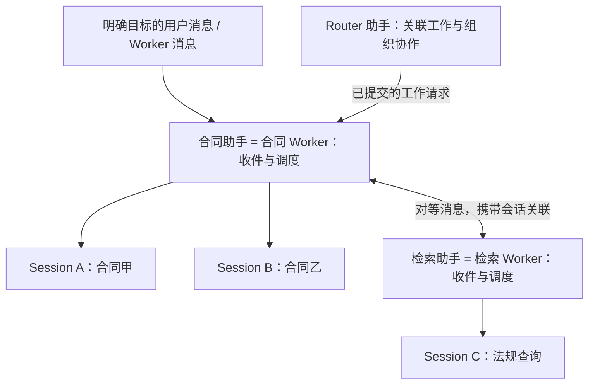
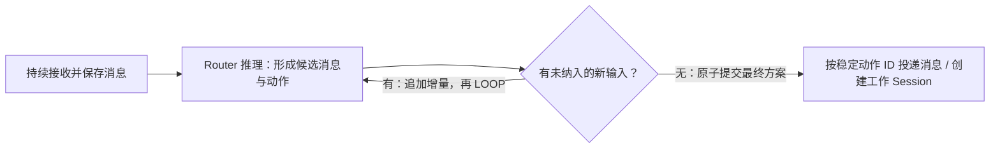

# Pie 助手 Worker 与持久协调设计

状态：进行中。已有对等通信、同步/异步等待和本地 Cowork 接入；本轮补齐同步等待的 30 秒分段返回、阶段进展唤醒及主助手沟通指引。更新：2026-11-11。

本轮范围：复用 Worker 的 `communicate`、持久消息与模型调用间隙接纳。同步等待每段最长 30 秒；新输入可提前交回模型，`waiting` 不代表工作完成，模型可用原 `message_id` 续等。真实回应仍优先领取并原子消费。主助手按实质信息汇报，约 60 秒保持沟通属于模型软规范；工具卡心跳只用于展示。普通 Session 的 `task`、Amio 链路、异步让出和取消归属保持原行为，不新增工具、配置或消息存储。

2026-11-06，开始接入本地 Cowork Pie adapter：新会话的空 Worker 工作关联、独立协作目录、自主回合产品绑定与事件/权限接续。实现限定 Pie 和 Cowork `adapters/pie`，不修改 Amio、公共 Core contract 或 ACP 主流程；Router、端云和重启自动恢复仍不在本次。验收覆盖真实 Pie 源码进程、SQLite 和 faux 模型，以及现有 Core/Amio 契约回归；客户端人工验证与源码测试分开记录。

已获准按步骤实施并汇报进度。首期在本地 Astron Cowork + Pie 实现，端云协同在本地链路验收后推进。前置来源见 [DeepSeek Super-agent 评估](../deepseek-super-agent-assessment.md)；下述助手与 Worker 的对应关系是本次 Pie 讨论确定的模型，不代表 DeepSeek 原型的实现。

## 问题与目标

现有 `task` 将助手协作表达为父 Session 调用子 Session，再等待或接收结果。目标改为：长期助手之间平等通信，每个助手管理自己的多个工作会话；新工作、补充、追问和回复都能持续进入正确上下文。

例如：合同助手同时审合同甲、乙，分别使用 Session A、B。A 向检索助手请求法规，检索助手在 Session C 处理、追问并回复 A；B 同时继续执行，整个往返不需要 Router 转述。

保留现有聊天、模型、工具、Skill、MCP、权限、压缩、历史、产物与停止能力。新协调模式以消息协作替代 `task`；旧路径只承担过渡兼容，不作为新架构的调用协议。

已实现 Local Assistant 与逻辑 Worker 共享生命周期：创建助手立即建立稳定 Worker 身份，更新助手刷新 Worker 配置，删除助手清理 Worker 记录；Worker Session 仍按具体工作懒创建，不为每个助手预建空 Session。

已补齐三个边界：取消/失败后的收件截止点随终态持久化，重启不能复活旧输入；删除 Session 同事务停止其工作关联、取消等待并终结尚未受理投递，保留历史事实及其他 Session；停止的 Worker、工作关联或工作项不能继续从运行中 Turn 新发消息，SQLite 插入前再次校验，幂等重试仍返回原事实。验收覆盖重启、新请求不被旧截止点误伤、删除后不重建和停止/发送竞争；不扩展为重启自动续跑或完整工作项控制 API。

## 确定的领域关系

| 对象 | 含义与关系 |
| --- | --- |
| Cowork assistant / Pie Worker | 同一长期助手身份在产品层与执行层的表达；同一宿主授权域内 1:1，可复用 assistantId 作为逻辑 workerId |
| Worker 内部调度 | 接收消息、确定所属 Session、安排执行、维护等待与唤醒；不承载所有工作的共同聊天历史 |
| Session | Worker 处理某项工作的独立上下文；一个 Worker 可有多个 Session，首期一个工作 Session 只关联一个工作项 |
| Turn | Session 内的一轮模型与工具执行；一个 Session 可经历多个 Turn，等待回复后可以新 Turn 继续 |
| WorkItem，工作项 | 业务目标、授权范围与结果；可关联多个助手的工作 Session，不独占任何一个 Worker |
| Router | 一种助手角色，同样由 Worker 和 Session 承载；负责接单与跨助手协调，不是消息传输的必经节点 |

Worker 是逻辑身份，不等于常驻进程或单个 Agent 实例。空闲 Session 可以按现有策略释放 Agent，后续加载自己的历史。某个工作结束不关闭整个助手。

不同 Worker 可以并行；同一 Worker 的不同 Session 也可以并行，受宿主总并发与助手配额限制。同一 Session 的模型调用和 Turn 准入保持串行，不能用一个 Worker 全局执行锁阻塞所有工作。

## 首期范围与本地分层

首期使用本地 Astron 产品态和本地 Pie HTTP/SSE，复用现有助手管理、会话绑定与聊天展示。先验收本机完整链路，再扩展远端执行、共享存储与执行接管；首期不新增云服务、消息中间件、跨设备协议或 Web UI。

| 位置 | 本次职责 |
| --- | --- |
| Astron 宿主 | 提供账号与授权域、assistant 配置与可协作目标、默认工作目录、产品会话绑定、用户交互、状态与结果展示；拥有 Pie 进程和实际工具环境 |
| Pie 协调模块 | Worker 身份映射、持久收件、工作项与 Session 关联、Worker 内部调度、通信与等待、Router 决策、停止意图和对账 |
| Pie Runtime | Session / Turn、模型与工具执行、历史与压缩、权限交互、输入接纳与执行收据、安全恢复 |
| Pie Local / Server | Local 实现 SQLite 存储与本地能力；Server 负责本地装配、必要控制接口及 HTTP/SSE 转换，不放产品业务决策 |

计划以 `packages/runtime/src/coordination.ts` 提供可选 SDK 入口，复用已有 Agent Loop，不先拆新包或启动独立调度进程。Runtime、存储和能力由宿主注入；协调模块不导入 Local，不关闭共享 Runtime/MCP 等资源。

Astron 当前相关入口位于 `E:\Projects\cowork3\engine\servers\astronverse-agent\src\astronverse\agent`：`adapters/pie/runtime_config.py` 将助手投影到 `/host-runtimes`，同目录的 `transport.py` 创建绑定 assistantId 的 Pie Session，`runtime/services/session_service.py` 与 `store/session_bindings.py` 保存产品会话归属。实施时从这些既有入口接入，不建立另一套助手或插件注册表。

本轮只读对照 `/workspace/cowork3-ref/cowork3`：`cloud/tsconfig.pie.json` 直接检查共享 Runtime，`cloud/docs/assistant-config-refresh-validation.md` 约定 Session 固定助手身份、后续 Turn 采用最新注册修订，`cloud/apps/agent-service/src/server/session/session-record.ts` 保留产品会话及模型选择。Pie 据此从现有 `HostRuntimeDefinition.assistantId` 注册同 ID 的逻辑 Worker，不复制 Astron 助手/插件配置；目录、模型与 `productBinding` 由可信宿主为目标工作明确选择。参考树只读，Cowork 变更须在内网完成。

优先复用 Astron 当前管理的本地 Pie 实例，协调状态单独维护 schema。业务 Session 按所属助手进入现有产品绑定；内部 Router 协调 Session 由宿主明确标识和过滤，不污染普通会话列表。未启用新模式的 Session、群聊、事件流与旧 `task` 保持原路径，不自动迁移旧历史。

Agent Core 不识别业务工作项。新模式通过可选的会话工具与执行控制注入提供通信及让出能力；不把 `runSubagent` 改名后继续当作对等通信，也不通过 `parentSessionId` 表达协作关系。

## Worker 内部调度

收件与执行解耦。消息先保存到目标 Worker 的收件箱，再由内部调度关联 Session；确定性关联先执行，不为每条消息额外调用模型。

| 收到的输入 | 调度行为 |
| --- | --- |
| 明确的目标 Session | 核对 Worker、工作项和访问范围后投递原 Session |
| 带 reply_to 的追问或回复 | 根据原消息的可信往返关联定位 Session，不按助手最近聊天猜测 |
| 已有唯一工作关联的补充或请求 | 继续该 Worker 对应的工作 Session |
| 明确的新工作或新会话请求 | 持久记录创建意图，幂等创建该助手的根 Session，再保存绑定 |
| 无法唯一确定归属 | 保留待澄清，向来源返回需要的关联信息；模型辅助消歧不作为首期可靠投递的前提 |
| 目标 Session 繁忙、等待或已停止 | 繁忙时继续收件；等待时按条件唤醒；停止时保留明确结果，不自动重新启动 |

Session 使用目标助手的配置、宿主选择的模型与工作目录；不能隐式继承发送方的目录、完整历史或审批记忆。配置和 Skill 刷新沿用现有边界，不冻结为一份永远不更新的 Worker 副本。

每个目标 Session 按接收序号取批。模型/工具批次运行时继续收件，在下一模型调用间隙安全接纳；空闲时启动下一 Turn。工作即将结束时须重新检查待输入，并处理检查与新消息并发，防止最后一条消息落盘后无人唤醒。

第 2 步先交付持久收件与 Session 内 FIFO 执行；第 3 步接入模型调用间隙的持久批次接纳和通信唤醒。繁忙时继续保存消息，错过本轮接纳间隙的输入在前一 Turn 完成生命周期清理后启动下一 Turn；不同 Session 不互相等待。不把现有 `durable: false` 的 steer 当成可靠收件。取消或失败会阻止此前已排队补充自动重启；已受理或派发结果未知的记录保持可核对，不因重试盲目再执行。

调度只在认领、关联与保存等短操作中串行，不持有队列锁等待某个 Session 的整个模型或工具执行。异步等待释放当前执行；同步等待每段占当前 Session 的工具调用，期间不发起模型请求，其他 Session 可以继续。每段最长 30 秒，新输入可提前交回模型；分段返回不终止原请求，仍需结果时以原消息 ID 续等。

## 对等消息与模型侧接口

新模式不向模型提供 `task`，也不沿用 `task_id/background` 的父子调用协议。助手协作统一使用消息；追问、回复、进度和结果属于不同消息类型，不再另设一套 `worker_report` 通路。

第 3 步模型接口及共享 TypeScript 契约已实现：

| 接口 | 行为 |
| --- | --- |
| `communicate({ to, content, kind?, session_id?, reply_to?, new_session?, wait? })` | 向获准 Worker 发送消息并保存收据；request/question 默认等待回应，`wait: false` 只发送，reply/result/progress 默认只发送 |
| `communicate({ message_id, wait? })` | 以已有消息 ID 续等，不重复发送；`wait.mode` 取 sync/async，省略时用宿主 `runtime.workerWaitMode`，再缺省为 async |

第 3 步实现范围：Worker 根 Session 持久保存 `workerId`，助手协作工具统一为 `communicate`，旧普通 Session 保留原路径。宿主可通过 `workerTargets` 独立提供主动目标的助手身份、名称与说明，省略时回退到 `subagents`，显式空数组禁止主动目标。合法因果回复允许沿原消息返回，不要求反向主动授权。来源身份和稳定调用键由 Runtime 注入，模型不能传入目录、模型、产品绑定或来源身份。Local 自动装配，嵌入宿主通过可选通信接口注入。

等待登记与回应检查同事务完成，避免工具返回和新 Turn 双重消费。同步等待优先领取匹配回应；每段结束仍为 waiting 时，模型可接纳新输入、向用户汇报并继续等待，不登记 `Turn.yield`。异步等待保存事实后立即返回工具结果；状态为 waiting 时模型正常生成面向用户的收尾，收尾消息及工具结果保存后，Runtime 才以 `Turn.yield` 记录让出并释放执行。异步收尾期间新收件持久排队，不插入当前 Turn，前一 Turn 完整清理后在原 Session 启动新 Turn。其他模型调用间隙仍可批量接纳已关联消息，历史与投递消费同事务保存；取消持久撤销本 Turn 的等待和自动回复唤醒。Router 增量推理、产品界面改造、分层工作项控制及重启自动恢复不在本步。

普通请求默认沿唯一工作关联复用目标 Session，无关联时创建本工作的新 Session；`new_session: true` 明确要求新的独立会话，与 session_id/reply_to 互斥。有多个候选时不得任意选一个；session_id 与 reply_to 同时出现时必须指向同一合法目标。

kind 默认为 request；question/reply/progress/result 必须关联已有请求或会话，不因关联缺失而新建工作。只有新请求可要求 new_session；携带 reply_to 时，to 和目标会话必须符合原消息的合法往返关系，否则拒绝。

可信收件上下文须向模型说明回应方式：有来源 Session 的 request 完成后，用 `communicate` 向来源 Worker 发送 `kind: result` 和原消息 `reply_to`；有实质阶段成果或阻塞时，以相同因果关联发送 `kind: progress, wait: false`；回答 question 使用 `kind: reply`。提供当前消息的准确回信参数，说明普通 assistant 正文只保留在本 Session。收到 reply/result/progress 不要求自动确认，避免循环互答；没有可回复来源的宿主输入不生成回信要求。主助手执行期间约 60 秒保持沟通属于模型软规范，不由运行时定时生成正文；工具卡心跳只展示活动，不作为阶段进展注入模型。

发送方 Worker、Session、Turn、toolCallId、授权域和工作归属来自真实调用上下文，模型不能自行填写或冒充。工具重试使用稳定调用键；同键不同参数拒绝。目标列表包含可联系助手的 ID、名称和用途，按宿主授权提供，不扫描或暴露所有用户的助手。

`reply_to` 可以形成连续往返：A 发请求，B 对该请求追问，A 回答该追问，B 返回结果。每一步保留可信来源和因果链，不能只匹配助手名称；回复默认投给对应的原请求 Session，不能送入该助手的另一个工作。

消息与投递意图先落盘，才返回收据；尚待创建或关联 Session 的投递保留待路由状态，目标确定后再接纳输入。“已保存”不等于“已受理”“已消费”或“已完成”。重复发送只形成同一消息和投递记录；结果未知时核对原收据，不生成新 ID 盲目重投。

独立通信只依赖协调模块、Runtime 与存储。Router 空闲、忙于其他推理或暂停接单时，Worker 仍能直接请求、追问、回复和唤醒；不为这些消息建立 RouterDecision。授权范围内允许跨工作项交流，工作项与会话归属不因此合并。

### 等待与唤醒

当前行为（2026-11-11）：同步等待每段最长 30 秒，或在有待接纳新输入时提前返回 `wait.status: waiting`，分别带 `reason: interval/message`。返回前再次原子检查 question/reply/result，已到达的匹配回应优先沿工具结果领取。progress 使模型有机会处理进展，不表示回应 ready 或工作完成；新输入仍由 Runtime 在下一模型调用前与历史同事务消费。`timeout_ms` 仅由用户明确要求时指定，是本次等待调用的上限；大于 30 秒先返回 interval，续等从新调用重新计时，不累计为整项工作期限。原请求、异步让出及取消边界沿用既有机制。

2026-11-09 历史范围（同步分段行为已由本轮调整）：同时保留同步与异步等待。Cowork 普通助手的 Pie runtime 默认 sync；其他 Pie 宿主维持 async。同步等待直接占有属于该请求的未消费回应，在保存工具结果的同一事务标记消费和等待 ready；常规收件与下一 Turn 不得重复接纳它。result、question、reply 可结束等待，progress 不结束等待。同步默认持续至匹配回应、明确失败或取消，仅显式 `timeout_ms` 才返回 timed_out，原请求仍存在；提示模型仅在用户要求时设置时限。取消停止本次等待，沿原源 Turn 取消规则处理迟到回复，不沿消息关系取消对端。拒绝等待当前同一 Session；跨 Session 互等默认须由回应或用户取消解除，不增加全局等待图。进程中断后的未知工具结果仍受既有恢复门禁约束，不自动重放。

Cowork Pie adapter 将可信发送调用映射为已有 `tool.subagent` Task 卡和执行详情，按 messageId、delivery 与实际接纳 Turn 限定本次内容；不修改 Worker Session 的独立归属，不发送虚假的父子事件。前端只抑制已有 Task 投影对应的重复往来卡；普通来信隐藏、旧历史和 Amio Task 保持现有行为。本次不新增任务框架、全局互等图、真实提供商调用、构建或部署。验收覆盖同 Turn 收回信、早到回应、追问、超时、取消、重复消费、异步不回归，以及 Cowork 实时/历史投影和 Amio 契约。

登记等待时，必须与“对应回应是否已经到达”一起原子检查：先到的回复立即可消费；后到的回复只登记一次唤醒。若在等待中收到需要处理的新输入，应先恢复处理输入，保留尚未满足的回复关联，不能因只等某一回复而忽略对方追问。

异步等待使用结构化执行控制：协调模块先保存等待意图，Runtime 保存让出执行事实和有效 checkpoint，再正常结束当前 Turn；交接期间到达的回复保留待唤醒记录，不能并发启动第二个 Turn。让出不能留下没有结果的工具调用，也不能只写一条“我在等待”的普通文本或靠轮询、永久挂起 Promise 代替。让出不是取消，Turn 正常结束不等于工作完成。

对端回复后从原 Session 历史继续；已明确停止的请求或会话不被迟到回复自动恢复。发送不产生父子取消权，对方可以按自己的授权处理、追问、拒绝或报告受阻。

### 异步等待轮的模型收尾（源码与自动回归已完成）

问题：此前 waiting 工具结果保存后，Runtime 立即停止 Agent loop，模型没有机会生成正常最终回答，主聊天只剩工具前过程文字。现改为“登记等待 → 模型正常交代 → 保存收尾并结束 Turn → 回信新 Turn”。模型生成真实正文，不在前端补固定回答，不把工具前文字或思考提升为最终回答。

本次仅修改共享 Runtime 的停止时点和 wait 工具指引，复用现有持久等待、输入队列、取消与失败处理，不增加 Agent API、轮询、收尾专用模型或调度服务。等待状态为 ready 时沿原路径继续；waiting 时保持 yieldRequested 阻止收尾间隙接纳来信，直到无工具调用的 assistant 消息完成再正常让出。模型取消/失败按原终态处理，不伪装正常收尾。

验收使用真实 Runtime、Scheduler、SQLite 与 faux 模型：等待后持久正文存在且先于 Turn 结算；无回信时释放执行；收尾期间到达的回信在同一 Session 的新 Turn 仅消费一次；已就绪、取消与失败不回归。运行定向测试、`npm run check`；不调用真实模型、构建、部署或自动提交。Cowork 既有展示消费正常正文，无需改 Amio Core。

## 助手往来展示（历史方案；当前复用 Task 展示）

当前决定（2026-11-09）：来源助手的通信调用复用原 Task 头像、卡片及只读过程；子助手收到 request/question 使用普通消息组件，取消独立往来小卡。以下保留 2026-11-06 初始方案背景，实际现状以本轮实施记录为准。

桌面联调已观察到 Worker 回信进入来源会话，但正文被当作用户消息展示，缺少助手来源与往来入口。模型输入的 `role: user` 不代表真实用户发言，产品展示须根据可信通信来源区分。

- **主聊天：** 本次协作显示可点击的“与代码助手 · 2 条消息往来”，附实际状态，例如“等待回复”“有新消息”“已收到结果”。Worker 收件不占用用户消息气泡；主助手面向用户的正常回复继续展示。`send_message/wait_message` 工具记录可在执行详情查看，保留原始历史。
- **往来详情：** 标题展示“星小妙 ↔ 代码助手”，按实际发送方展示名称、头像、方向、时间、正文和文件引用；请求、追问、回答、进度和结果按消息顺序呈现。本阶段只读查看双方显式发送的通信消息；跳转工作 Session 待产品绑定与导航入口确认后接入，不按原生 ID 猜测产品会话。
- **关联与计数：** 详情是已有消息事实的视图，不新建执行 Session、群聊或父子 Task。以原请求因果链及实际两侧 Session 确定本次往来，同一对助手的其他任务不混入；一项工作中涉及第三个助手时可分别查看对应往来。按稳定 messageId 去重计数，投递重试、工具流及普通模型正文不重复计数。
- **状态：** 等待来自持久 waiting/yield 事实，显示“等待代码助手”，允许用户继续聊天；已让出的 Turn completed 不显示为整项工作完成。收到 result 标记“已收到结果”，失败结果明确展示失败；主助手后续执行、人工确认与最终面向用户的答复仍沿实际生命周期显示。切换会话、刷新和重连须保留同一来源与状态。
- **数据接口：** Pie 提供结构化消息身份、发送/接收 Worker 与 Session、kind、replyTo 和时间；Pie adapter 映射至产品消息/事件的通信来源，前端据此呈现。来源取自持久消息与投递关联，不解析正文猜测、不改模型角色、不把来信改成主助手自己生成的回复。已有消息按可核对的消息身份补充关联，信息不足时不冒认发送者。

落地顺序：先补齐 Pie 到 Pie adapter 的可信展示数据并保证实时与历史一致，再接 Cowork 主聊天入口和往来详情，最后验收多任务隔离、等待/回信、失败、产物和重连去重。2026-11-06 用户已授权本阶段修改 Cowork 前端；实现范围为 Pie 输入展示元数据、Pie adapter 和聊天组件的显式通信展示，不改变模型角色、普通聊天、旧 Task、Amio 和现有执行控制。测试选择 T2（跨宿主元数据契约）与 T1（分组、去重和界面交互），桌面真实模型人工验收单独记录。

## 最小持久事实

协调存储不复制完整 transcript。Session、Turn、输入节点和工具账本仍由 Runtime 保存。

| 事实 | 保存内容与约束 |
| --- | --- |
| Worker | 授权域、assistantId、启停意图、配置关联与获准目标；不绑定单个工作项或单个 Session |
| WorkItem | 业务目标、来源、授权范围、状态、结果与待人工问题；状态不是某个 Turn 的直接副本 |
| Assignment，工作会话关联 | WorkItem、Worker、Session、请求/创建键和停止意图；多个助手可参与同一工作，各自保留上下文 |
| Message / Event | 稳定 ID、可信来源与来源会话、目标 Worker、目标会话或路由意图、类型、正文/引用和 replyTo；外部来源也保存原事件 ID |
| Delivery / 输入批次 | 消息、目标 Worker、待关联或已确定的 Session、接收序号、批次集合、Runtime 受理与消费收据；接纳记录须与历史输入同事务保存 |
| 等待与调度状态 | Session 正在等待的消息、待唤醒事实、暂停/停止状态；可与工作关联同存，不要求独立服务 |
| RouterDecision | 协调 Session、已纳入输入位置、候选动作、提交状态和稳定动作 ID |
| Subscription / Outbox | 外部讨论到工作会话的明确关联、待发送外部消息与发送收据；不把 SSE 当持久队列 |

`createSession` 已补齐可选持久 `creationKey` 与创建收据查询；第 1 步已有可跨 Turn 查询的输入批次事实，第 2 步补充 Worker 收件与投递收据。第 3 步通过 `SessionWriteOptions.workerInputs` 将 Worker 输入历史与对应投递消费同事务保存；第 1 步通用输入批次接口不自动获得该执行能力。协调意图与 Runtime 存储可能不在同一事务，必须靠稳定创建键、输入收据与对账跨越窗口，不能假定跨库原子提交。

首期允许持久记录事实但不自动恢复所有执行。已确认接纳的输入不重复提交；模型或工具结果不明时受阻待核对，不承诺未知副作用恰好执行一次。

## Router 持续接单与提交

Router 使用一个专用协调 Session 串行处理该入口的待路由消息，复用 Worker 身份、收件和通信机制。普通助手的内部会话调度不依赖 Router 模型。已明确目标的用户输入、订阅补充与 Worker 间消息直接到目标，不先经过全局 Router。

例如：Router 读到①“调研 A”开始推理，期间收到②“A 加上权限要求”和③“另行调研 B”；本轮结束先读增量并再推理，若再来④则继续。直到提交时没有未纳入的新信息，才正式向对应助手发出工作请求。

- 推理期间的协作发送和对外回复只形成候选动作，不能提前投递或创建业务 Session。当前 Pie 可流式启动工具调用，需为 Router 增加延后提交机制；候选收据只能表示“计划已记录”，不能冒充“消息已发送”。Router 不等待尚未提交动作的回复，提交后的回应由后续收件继续处理。普通 Worker 的消息照常立即保存和投递，只读查询不受此限制。
- 最后检查本协调 Session 的收件位置、停止意图，登记最终决策与待投递/外发动作，在同一协调存储事务中完成；有增量则继续推理。正式提交后再到达的输入属于下一轮，不能回滚已经执行的动作。
- 每轮保存准确消息集合和截止位置，增量追加上下文，不从零重读历史。上下文预算未能纳入的消息继续保留，不能跳过后直接派工。
- 不额外等待凑批窗口；重复事件、普通状态更新及发给其他 Session 的输入不触发重算。已有工作 Session 的执行和通信不因 Router 追读而暂停。

待决：持续高频来信可能长期推迟提交，是否设置追读时间或轮数上限需另行确认；本 SPEC 不擅自改变“有增量再推理”的原则。

## 停止、权限与业务结果

[Turn 所属后台作业取消修复](background-job-cancellation.md)已提交（`0da6bfa0c`），作为旧执行路径基线。新模式须补齐独立根 Session 的控制，不能依靠原 Subagent 父子信号链，也不能把整个助手的停止等同于某项工作的取消。

| 控制范围 | 语义 |
| --- | --- |
| 取消 Turn | 只取消准确 Turn 和它所属的本地工具/作业，等待清理后结算；撤销该轮已取消请求的自动等待唤醒，不沿普通消息关系关闭对端 Worker |
| 停止 Session / 工作请求 | 保存停止意图，停止相应投递、等待与执行，并处理其登记的遗留作业；同助手其他 Session 不受影响 |
| 停止 WorkItem | 按授权工作关联停止各 Worker 中属于本工作的请求/Session 和遗留作业；不停止这些助手参与其他工作的 Session |
| 停止 Worker | 宿主明确请求停止整个助手的调度和所属 Session，并核对遗留作业；消息不能自动获得这个控制权 |
| 暂停 Router 接单 | 暂停它的新派工与对外发送；其他 Worker 已有执行、内部通信与唤醒继续 |

发送方 Turn 正常结束不撤销已保存的协作消息。取消当前 Turn 不等于停止整个工作项；如需停止跨助手协作，宿主须明确执行工作项/请求控制，不能让界面显示已全部停止而对端仍在执行。旧 `task` 路径保留已修复的所属作业取消语义。

停止意图先落盘，再发出控制；创建在途、已排队输入、回复到达和启动下一 Turn 都需再次核对。迟到回复保留可查询结果，不复活已停止的请求；用户明确恢复或发起新请求时再建立新的执行关联。外部任务保留“取消已请求”和“确已停止”的区别。

消息权限以宿主批准的协作关系和两侧数据范围为准；通信不扩大工具权限、共享审批记忆或修改对方工作归属。工具策略取实际助手权限与工作授权的交集，配置刷新不自动扩大既有工作授权。

工作项结果只核对该工作的关联 Session、未决输入、等待和后台作业，不等待整个 Worker 的其他工作全部结束。进度更新工作状态；追问和结果发给原请求者，需要统一协调或对用户汇报时再投 Router/宿主。人工权限请求仍属于实际执行 Session，经原交互接口回答；报告、普通文本或 `turn.settled` 都不能单独证明业务完成。

不同 Session 的上下文隔离不等于文件隔离。同一助手可能共用默认目录；并行修改相同文件时须由宿主选择独立工作目录或限制冲突操作，不宣称本设计已提供文件沙箱或自动合并。

## 兼容与迁移

新模式按宿主明确配置/装配启用，首期新建受协调的工作 Session。旧会话、历史 `task` 记录和未启用模式的前后台 Subagent 继续按原协议读写，不自动转为对等消息，不混用 task_id 与 workerId/sessionId。

新模式保留“启动后继续其他工作、等待结果、续用历史”的能力，通过发送、等待与回复表达。模型工具目录切换为通信接口；`job_output/job_kill` 仍用于现有本地 Shell/Task Job，不把 Worker、消息或 Session 注册成内存 Job 冒充持久协调。

模型选择、Skill/MCP 与工具装配、压缩、产物和权限继续复用现有接口。Astron 需适配新消息状态与来源展示，保留旧任务卡片/历史读取；新协议在本地验收后才决定扩大启用范围。撤回新入口时保留协调数据与受阻记录，不删除数据库作为回滚。

## 分步演进路线

第 1～6 步均在本地 Astron + Pie 范围内推进；第 7 步才引入端云协同。每步实施时更新本 SPEC，记录实际文件、命令与结果。

| 步骤 | 交付 | 本步验收 |
| --- | --- | --- |
| 1. 可靠执行与控制契约 | 可选幂等创建键、持久输入批次/收据查询、运行中安全接纳、结构化执行让出及宿主停止遗留作业能力 | 同键不重复建 Session、冲突拒绝；受理结果可查询；保存失败不启动模型；让出记录完整且不产生重叠 Turn；停止能等到清理 |
| 2. Assistant = Worker 与内部调度 | 从 Astron 配置注册逻辑 Worker；接通 Worker 多 Session、工作关联、目录/模型选择和产品绑定，使用 Local SQLite 保存调度事实 | 一个助手同时处理甲乙，Session 独立并行；补充只到原会话；同 Session 不并发执行；取消甲不影响乙 |
| 3. 对等通信替代新路径 task | 注入 send_message / wait_message，完成可信消息关联、去重、接收、追问、回复、等待和唤醒；提供获准目标与收据查询 | 合同助手与检索助手双向往返；Router 空闲或忙碌时照常通信；回复不串会话，先到回复不漏唤醒；双方等待不占满执行配额；越权发送拒绝 |
| 4. Router 增量推理与提交 | Router 作为一种助手角色，候选消息延后执行；有增量再 LOOP，无增量才提交并投递最终动作 | ①推理期间到达②③触发下一轮，④再触发追读；旧候选不发消息或建会话；边界竞争和重试不重复派工 |
| 5. 本地 Astron 完整闭环 | 打通现有 Cowork 助手/聊天入口、会话绑定、消息状态、权限问答、工作项停止和结果产物展示；用两个本地来源替身验证订阅与外发关联 | 经真实本地产品协议完成新工作、补充、协作、等待、回复和停止；旧聊天、群聊、任务历史与工具回归通过 |
| 6. 本地重启对账与安全恢复 | 核对消息、会话创建、输入收据、等待、决策与停止意图；仅按已有安全条件恢复 Turn，未知副作用保持受阻 | 各提交窗口退出后可找到原记录；不重复已确认输入和动作；人工停止不被恢复撤销；未知 Shell/工具不重放 |
| 7. 端云协同 | 在本地验收后设计远端投递、存储/执行适配、执行归属与代次隔离、离线对账，再补预算和监督 | 本地与云端不同时执行同一 Session；迟到旧结果不覆盖新归属；断连可核对消息与结果；跨端授权与停止有效 |

第 1～5 步形成首个本地可用版本，第 2、3 步可独立演示助手调度与通信。第 6 步之前，异常状态须可查询并明确受阻，不承诺重启后自动续跑；完成本地恢复验收后再进入第 7 步。

## 验收与实现入口

验收使用 faux 模型、真实 SQLite、本地工具及可控消息来源，不使用付费提供商或真实外部渠道。除 SDK/HTTP 测试外，必须验证 Astron 现有创建会话、prompt、事件回传、产品绑定和展示链路；源码测试不代替本地客户端验收。

- **身份与调度**：同一 assistant 只有一个逻辑 Worker，拥有多个工作 Session；消息按明确关联进入正确会话，繁忙会话不阻塞其他会话。目标目录、权限、模型和历史不继承发送者。
- **可靠输入**：创建、发送、回复和输入批次重试保持原身份；落盘失败不执行；受理响应丢失查收据；重复/乱序到达可核对，未知执行不盲目重放。
- **独立通信**：Router 模型被门闩暂停时，合同助手的 Session A 与检索助手的 Session C 完成请求、追问、补充、结果往返，期间同一合同助手的 Session B 继续；Router 不增加模型请求。覆盖先回复后等待、回复与让出竞争、新输入唤醒、回复到错会话与越权目标。
- **Router 提交**：覆盖推理增量、预算未读完、候选流式工具、最终检查竞争和重复投递；普通进度及其他 Session 收件不触发全局重算。
- **停止与状态**：按 Turn、Session、工作项、Worker 分别验收；正常结束保留后台工作；停止甲不影响乙；迟到创建、输入与回复不能恢复已停止请求；已停止与结果未知明确区分。
- **兼容与本地集成**：验证普通聊天、群聊、旧 task、模型覆写、Skill 刷新、MCP、权限记忆、压缩、产物和 SSE；新消息准确回到现有 Cowork 会话。共享目录的冲突行为另行验证，不用上下文隔离冒充文件隔离。
- **恢复与端云**：本地恢复按第 6 步单独验收；第 7 步的多实例与端云测试不提前记为完成。

预期代码位置：Runtime 的 coordination/protocol/runtime/agent/tools 提供共享契约与执行接入，Local 提供 SQLite 适配，Server 提供本地宿主装配；Astron 修改助手投影、Pie transport、SessionService/会话绑定及必要的聊天状态展示。具体新增文件与 TypeScript 声明在实施前定稿，不承诺当前已经存在这些接口。

实现后按仓库规则运行 `npm run check` 和最小相关回归；新增/修改测试必须实际运行。既有后台取消修复的测试结果不计为本功能验收。

## 实施记录

2026-11-05，第 1 步基础已在 `335d47598` 提交，包含创建/停止契约及三项协调事实：

- **已实现：幂等创建与核对。** `createSession({ creationKey, ... })` 同键相同参数返回原会话，冲突拒绝；SQLite 创建记录与会话同事务提交，删除会话保留键。SDK `getSessionCreation` 和 HTTP `GET /session-creations?creationKey=...` 可核对响应丢失。未实现存储能力的旧适配器仍可普通创建，带键请求明确返回 405。
- **已实现：宿主停止遗留作业。** SDK `cancelBackgroundJob` 与 HTTP `POST /sessions/:id/jobs/:jobId/cancel` 接收 instanceId、executionId，绕过普通队列并等到直接 Shell/Task 清理；不唤醒模型。每次作业启动生成新的 executionId，避免 Task 复用 ID 导致迟到请求误停新执行。该回执 `durable: false`，不伪装持久工作项停止。
- **关键文件：** Runtime 的 `runtime.ts`、`runtime-store.ts`、`protocol.ts`、`jobs.ts`、`index.ts`；Local 的 `store.ts`、`runtime.ts`；Server 的 `server.ts`；协议说明维护在 `docs/runtime-embedding.md` 和 `packages/server/README.md`。
- **已验证：** `node --conditions=source --test packages/runtime/test/runtime.test.ts packages/server/test/store.test.ts packages/server/test/session-creation.test.ts`，75 项通过；`node --conditions=source --test packages/server/test/background-jobs.test.ts packages/server/test/background-cancellation.test.ts`，14 项通过。包括并发/重启/丢响应/事务回滚，真实 Shell 进程终止、后台 Task 清理、存储故障及迟到停止。测试夹具最后的类型修正后，单独重跑 `background-jobs.test.ts`，7 项通过。
- **全量检查：** `npm run check` 通过，包括 Biome、TypeScript 和模型目录校验；`git diff --check` 通过。
- **已实现：持久输入批次。** `coordination_input_batches` 保存稳定 `batchId`、输入身份、目标 Session、内容、指纹和状态；HTTP/Runtime 可创建与查询，重复请求返回原事实，身份冲突拒绝。重启后仍可查询，保存失败明确不启动模型执行。
- **已实现：安全接纳状态。** 输入批次按 `pending -> accepted -> consumed` 单向推进，接纳必须绑定准确 `turnId`，重复接纳可重试，不同 Turn 不能抢占；状态与输入正文分离于普通 transcript，供后续 Worker 调度在模型调用间隙消费。
- **已实现：结构化让出。** `coordination_yields` 保存 `yieldId`、Session/Turn、`waiting_for_message`/`paused` 原因和 checkpoint；重复提交保持身份，不使用普通文本或永久挂起 Promise 伪装等待。Runtime 提供让出记录入口，并拒绝已切换 Turn。
- **关键新增文件：** `packages/runtime/src/coordination.ts`、`packages/runtime/test/coordination.test.ts`、`packages/server/test/coordination.test.ts`；SQLite 适配在 `packages/local/src/store.ts`，Runtime/HTTP 入口在 `packages/runtime/src/runtime.ts`、`packages/local/src/runtime.ts`、`packages/server/src/server.ts`。
- **已验证：** `node --conditions=source --test packages/runtime/test/coordination.test.ts packages/server/test/coordination.test.ts`，3 项通过；覆盖幂等批次、单 Turn 接纳、结构化让出、HTTP 重试与 SQLite 重启读取。`npm run check` 通过。
- **边界与未完成：** 第 1 步提供持久事实和控制准入，不自动恢复所有执行；Worker 路由、回复唤醒、模型侧 `send_message/wait_message` 和让出后的自动续跑留在后续步骤。未做 Astron 客户端验收、构建或部署。

2026-11-05，第 2 步 Pie 侧实施与验收：

- **领域与存储：** `coordination.ts` 定义 Worker、工作项、Session 关联、消息与投递事实；`store.ts` 提供 SQLite 表、唯一关联、持久序号、重启读取和身份冲突校验。Worker 配置修订刷新保持逻辑身份；消息默认 request，明确关联、可信回复链和唯一工作关联优先，歧义保留 pending。
- **内部调度：** `worker-scheduler.ts` 先入箱后后台关联；稳定创建键幂等创建目标助手根 Session，保存目标目录、模型和产品绑定。每 Session FIFO，不持全局执行锁等待模型；同助手多 Session 并行。派发前保存意图，未知受理结果不盲重放；取消不沿普通工作关系影响其他 Session。`waitForTurn` 的同步观察回调固定准确 Turn 起点和结算，避免异步完整快照混入后续 Turn；取消前补充不复活，取消后显式新请求仍可执行。受理 Turn 在登记等待前已被替换时保留 accepted 待核对。
- **宿主装配：** Local 从现有 `/host-runtimes` 配置同步 Worker，提供 SDK 收件/查询/等待；Server 增加 `/workers`、Worker 收件及消息/投递查询。`createSession.astronSessionId` 纳入创建身份并沿现有导出保留产品绑定。关闭先停止调度，在 SQLite 关闭前等待收据写入；初始化失败关闭已创建的 Runtime。
- **验收通过：** 新增 `worker-coordination.test.ts`、`worker-store.test.ts`、`worker-scheduler.test.ts`、`worker-host.test.ts`、`worker-lifecycle.test.ts`，共 37 项通过。真实 Local/Runtime、SQLite、可控本地工具与 faux 模型直接验证一个助手独立并行处理甲乙、补充只到原会话、同 Session 串行及取消甲不影响乙；另覆盖 HTTP/重启收据、身份冲突、保存失败不执行、普通 Turn 竞争、取消前后输入、未知执行不重放和初始化/关闭资源边界。
- **基线测试收口：** 全量初跑发现 10 项既有失败，在 `335d47598` 的独立源码副本逐项复现。仅修正 7 个测试文件，沿用隐藏能力清单、技能请求上下文、SSE 轻量 execution、持久树节点和恢复序号的现行契约；保存失败夹具先进入准确模型执行窗口。定向 `node --expose-gc --conditions=source --test packages/server/test/{execution-state,fork,plugins,server,tool-progress,turn-recovery,working-history}.test.ts`，79/79 通过。
- **最终验证：** `npm run check` 通过（Biome、TypeScript、模型目录校验）；`npm run test:server` 发现 57 个文件，覆盖全部 runtime/server 及现有 prompt-viewer 测试，428/428 通过，无跳过；`git diff --check` 通过。只读核对源码并用行为回归收口，未提供 crapper/dryer/mutator 工具，未宣称运行它们。行动日志保存在 `/tmp/pie-superagent-step2-log.md`，关键设计、失败证据与结果已回填本记录。
- **偏差与后续：** 第 2 步按 Turn 结算边界消费 FIFO，不承诺本轮模型间隙持久批次接纳；该能力与 `send_message/wait_message`、可靠唤醒一起留第 3 步。重启后可查事实，自动恢复与未知结果对账留第 6 步。来源身份及范围由可信宿主保证，此 HTTP 入口不能直接暴露给模型。只读对照 Cowork 配置，未修改参考树；真实 Astron 产品链路须在内网联调，未计为本次完成。未构建、部署或调用真实模型。

2026-11-06，第 3 步 Pie 侧实施与验收：

- **工具与身份：** 新增 `worker-communication.ts` 共享契约。调度器创建的根 Session 持久保存 `workerId === assistantId`；`agent.ts` 在该路径注入 `send_message/wait_message`，不注册 `task`，配置重建和 SQLite 重启后同样生效。普通 Session 和旧 Task 保留原路径；原生工具名称禁止被外部工具覆盖。Local 自动装配，嵌入宿主可选注入。
- **可信往返：** Runtime 生成来源 Worker/Session/Turn 和稳定工具调用身份；主动目标复用获准助手目录，发送前核对当前授权。消息立即保存，不等待目标执行；合法因果回复可回原 Session，不要求反向主动授权。显式跨工作通信不改变双方工作归属，不继承来源目录、模型、产品绑定、历史或审批记忆。来源与关联元数据随输入历史保存，展示仅含正文。
- **等待与接纳：** SQLite 将等待登记与已消费回应检查放在同一事务；回应只由一个等待领取，并支持追问、补充、最终结果的因果链。等待工具返回后，Runtime 在整批工具结果保存完成时记录 `Turn.yield` 并释放执行；`execution.waitingForMessage` 与普通完成区分。运行中的已关联消息可在下一模型调用间隙批量进入原 Turn，历史与 `consumed/acceptedTurnId` 同事务提交，队列不重复开启 Turn。
- **取消与失败：** 取消运行中或已让出的准确 Turn，持久撤销等待及自动回复唤醒；取消后到达的消息保留可查结果，不唤醒已取消请求，不关闭对端 Worker。存储在接纳事务内再次检查取消，冲突回滚历史与全部投递。明确的接纳前失败产生稳定 `result` 回来源，包括目标尚未创建 Session 或显式跨工作目标尚未建立投递关联；已受理或派发结果未知时保留核对状态，不伪造失败或重放。
- **关键文件：** Runtime 的 `worker-communication.ts`、`worker-scheduler.ts`、`runtime.ts`、`agent.ts`、`protocol.ts`、`runtime-store.ts`、`coordination.ts`、`index.ts`；Local 的 `store.ts`、`runtime.ts`、`agent.ts`。接口说明及包变更记录已同步。
- **定向验证：** `node --conditions=source --test packages/server/test/worker-communication.test.ts packages/server/test/worker-agent.test.ts packages/server/test/agent.test.ts`，18/18 通过；`worker-communication-store.test.ts`，9/9 通过；最终 `worker-scheduler.test.ts`，28/28 通过。真实 SQLite、Runtime、Agent 与 faux 模型覆盖双向请求/追问/回复、同助手另一 Session 并行、早到回应、同 Turn 批量接纳去重、等待持久化与工具结果交接时的取消/回复竞争、配置重建与重启后工具隔离，以及明确失败回执。未调用真实提供商。
- **基线测试修正：** 全量首跑 465/466 通过，唯一失败为 Windows 临时目录清理早于 SQLite 关闭，触发 `model-request-retention.test.ts` 的 EBUSY。仅将该测试的 Runtime 关闭移入 `finally`；整文件 13/13、修正后全量 466/466 通过。
- **最终验证：** 补齐显式跨工作失败回执后，`npm run test:server` 覆盖 61 个文件，467/467 通过，无跳过；`npm run check` 通过 Biome、TypeScript 与模型目录校验；`git diff --check` 通过。全量日志保存在 `%TEMP%/pie-worker-step3-tests-final.log`。
- **范围与未完成：** 完成本地 Pie 的独立 Worker 通信；Router 增量提交留第 4 步，真实 Astron 产品入口/界面、分层工作项停止留第 5 步，重启自动对账续跑留第 6 步，端云协同留第 7 步。未修改 Astron，未做客户端实测、构建、部署或 Git 提交。

2026-11-06，本地 Cowork Pie adapter 接入，源码与协议阶段完成：

- **空工作会话与目录：** Local 的显式 `createSession({ assistantId, workerId: assistantId, ... })` 经 `WorkerScheduler.createWorkerSession` 补齐 WorkItem/Assignment，不生成用户输入或调用模型。同创建键可修补中途失败的关联，不承诺跨步骤事务。`protocol.ts/config.ts/runtime.ts` 增加独立 `workerTargets`；省略才回退旧 `subagents`，显式空数组关闭主动目标，发送再核验当前授权。支持 34 个助手各 33 个目标，不截断目录或扩大旧 Task 授权。
- **产品接续：** Cowork 的 `adapters/pie/runtime_config.py/transport.py` 投影目录和新直聊身份；`worker_bridge.py/core.py` 在现有生命周期接口中登记自主回合、绑定实际助手会话、保留等待信息和原权限路由。已有 Pie Core 映射优先复用稳定 Astron ID，拒绝错误助手认领，不重复建产品会话或切换活动 Core。未修改公共 Core contract、ACP 主流程、Amio adapter、前端或共享产品服务。
- **重连边界：** 用准确产品/Core/原生 Session/Turn 身份恢复快照副本，补齐可核对的旧终态；已登记回合的正文继续按 SSE 顺序处理。独立审核发现并复验了目录人数限制、快速结束后的准入、跨 Core 重复绑定、漏终态后长期 active 四项缺陷。若旧终态完全丢失且原生状态已经推进，缺少核对证据时仍受阻，不猜测结算或自动重放。
- **验证：** `npm run check` 通过；`npm run test:server` 为 474/474，日志 `%TEMP%/pie-worker-integration-server-tests.log`；后续目录边界修改的 runtime/server 两份 `worker-targets.test.ts` 共 5/5。Cowork 设置 `PIE_TEST_REPO=E:/Projects/pie` 后，19 份定向 pytest 合并 194/194，涵盖真实 Pie 进程、SQLite、faux、独立收发/等待/回复唤醒、产品身份、权限和共享 Core 契约；增强后的重连专项单独 11/11，独立复核再次通过。Ruff、文档和 diff 检查通过；未使用真实提供商。
- **已知基线与后续：** Cowork 异步边界检查 8 通过、2 失败，剩余 6 处后台任务与 7 处 OpenCode 命名违规均逐文件确认为 HEAD 原基线。事件中心测试曾出现时间戳差 1 ms 的不稳定失败，独立和最终合并回归均通过。聊天停止只控制在途 Turn；Pie/adapter 可精确撤销等待，但已结算工作尚无产品停止入口。桌面验收、来源会话代批、工作项控制、定时启动、重启自动续跑、Router 和端云仍未完成。未构建、部署或提交。完整 Cowork 命令与记录维护在其根 `specs/pie-worker-integration/plan.md`。

2026-11-06，桌面联调的 Worker 回信提示修复（源码验收已完成，更新后的桌面复测待办）：

- **现场事实：** 已切换 Pie；星小妙调用 `send_message/wait_message`，源 Turn 以 `waiting_for_message` 让出。请求投递已 consumed，代码助手自主完成 `adder.py` 的写入与运行验证，但只产生普通最终正文，未调用 `send_message`；源 Session 仍持久等待。界面的 6 秒已完成只对应源 Turn。
- **本次范围：** 只修 Pie 可信收件与通信工具提示，明确 request/question 的回信参数及消息类型；首次启动和模型间隙批次共用同一提示。保留对等显式通信和普通会话行为，不修改 Cowork、Amio、前端或共享 Core，不自动补发已有会话的结果。
- **实际改动：** `packages/runtime/src/runtime.ts` 的共用收件头为 request/result、question/reply 提供准确回信参数；`agent.ts` 补充 kind/reply_to 说明。`packages/server/test/worker-communication.test.ts` 捕获实际模型上下文，解析其中参数并通过真实工具链发送回信，验证因果唤醒、初始/间隙接纳、展示纯正文、无来源及普通文本伪元数据隔离、非请求消息不要求自动确认。运行时不自动转发最终文本。
- **验证结果：** `node --conditions=source --test --test-name-pattern="Worker model tools|two early Worker" packages/server/test/worker-communication.test.ts` 先以缺少具体回信参数红测 2/2；修复后完整 `worker-communication.test.ts` 7/7，`worker-agent.test.ts` 8/8。最后限定提示措辞后首个完整因果流程再次 1/1 通过；最终 `npm run check`（Biome、TypeScript、模型目录）与 `git diff --check` 通过。
- **边界：** 本轮只读现场已有模型记录，自动回归使用本地 faux，不新增真实提供商调用。提示依赖模型遵从，更新后的真实模型桌面闭环仍待复测；未构建、替换、提交或重启现有服务，已有等待不自动补发结果。

2026-11-06，助手往来展示方案补充（设计记录，未实施）：

- **新反馈：** 用户确认链路已通，并提供回信到达的主聊天截图；当前问题转向来信被渲染为用户气泡，以及缺少助手间通信详情。前次特定请求未回信的现场记录保留，不据此否定本次已到达的结果。
- **源码核对：** Pie `runtime.ts` 与 `session-transfer.ts` 保留 Worker 消息身份并清洗展示正文；Cowork `adapters/pie/worker_bridge.py` 将自主输入登记为 `userMessage`，`core.py` 的 `_transcript` 沿普通 user 角色投影，尚无完整通信来源供前端渲染。已有通信与执行事实可复用，展示按上述方案单独实现。
- **验证与范围：** 本轮为截图与源码核对，仅更新本 SPEC；未改执行代码、调用模型、运行构建、替换、重启或提交。前端展示、来源数据贯通及刷新/重连验收尚未实施。

2026-11-06，助手往来展示实施（源码与自动回归已完成，桌面人工验收待办）：

- **来源贯通：** `packages/runtime/src/runtime.ts` 在首次与模型间隙收件时保存安全的 `metadata.workerCommunication`，包括实际来源、目标 Session、消息身份、因果关联与正文；保持模型角色和输入行为。Cowork Pie adapter 为实时、历史和自主回合透传同一事实，名称复用现有助手目录；旧消息只按可信 ID 在有限数量和总时限内补查，补查失败不取消主加载。
- **实际展示：** Cowork 聊天 Core 校验、去重并按因果链及两侧 Session 分组；React `WorkerCommunication.tsx` 与 `ConversationThread.tsx` 展示“与代码助手 · N条消息往来”和只读详情。来信不再占用户气泡，普通用户消息、主助手正文和旧工具详情保留；只展示实际发送的消息，不读取对方思考或完整会话。虚拟列表、定位与已打开的详情均使用稳定通信身份。
- **等待和刷新：** 当前等待经可选 `SessionSnapshot.presentation_metadata` 映射到 `snapshot.session.workerWaiting`；显式 null 清除，旧水位不能恢复已清除的等待。公共 canonical 历史只保留白名单展示字段，ACP 在异步快照加载前固定覆盖水位；不改 Core 执行、审批、取消或 Amio adapter。安全间隙来信仅追加展示事实，不创建 Turn；Store 在原生历史到达后替换临时记录并保留附件。普通与旧历史的正文回声匹配排除可信 Worker 输入，防止吞掉同正文用户消息。
- **验证：** Pie `npm run check`、完整 `worker-communication.test.ts` 7/7 及 diff 检查通过。Cowork 后端展示与共享契约 62/62、设置 `PIE_TEST_REPO=E:/Projects/pie` 的真实 Pie HTTP/SQLite/faux 闭环 1/1，通过；独立审核的 snapshot/resume 定向回归通过。前端组件与投影 205/205、Store 196/196、旧历史合并 82/82，通过；Core/React 类型检查和本次定向 lint 通过。不将重叠测试相加，准确命令与基线问题见 Cowork `specs/pie-worker-integration/plan.md`。
- **边界与偏差：** 用户已授权前端修改；必要共享接缝仅为展示字段、可选快照载荷与覆盖水位。工作 Session 跳转暂未接入；Router、工作项控制、恢复和端云未计为本阶段完成。未使用真实模型、构建、打包替换、重启或提交，更新后桌面展示与真实模型闭环仍须人工验收。

2026-11-06，等待轮模型正常收尾（源码与自动回归已完成）：

- **实际改动：** `packages/runtime/src/runtime.ts` 只将等待的停止点延后到无工具调用的 assistant 消息完成；`agent.ts` 的 wait 描述要求正常交代后结束，不轮询。原 yieldRequested、模型间隙屏障、Scheduler FIFO 和完整清理边界复用，未修改 Agent API、调度器或存储。`docs/agent-development.md`、`docs/runtime-embedding.md`、Server README 和 Runtime changelog 同步行为。
- **行为回归：** `worker-communication.test.ts` 先在旧源码 6 通过/4 失败，复现无 final 及无法进入收尾阶段；修复后 10/10。覆盖收尾正文、收尾期间回信新 Turn 单次消费、取消与模型失败，以及 ready、早到回信、原交接窗口、其他 Session 和重启。`worker-agent.test.ts` 8/8，移除模拟旧 Runtime 立即停止的测试钩子；新增测试类型修正后 final 回信专项再次 1/1。
- **相关验证：** `node --conditions=source --test packages/server/test/worker-communication-store.test.ts packages/server/test/worker-scheduler.test.ts packages/server/test/worker-session.test.ts packages/server/test/agent.test.ts packages/runtime/test/worker-coordination.test.ts`，59/59。最终 `npm run check` 完整通过 Biome、TypeScript 和模型目录校验。Cowork 仅加强 `test_pie_workers.py` 的真实 Pie HTTP/SQLite/faux 跨仓测试，1/1，通过公开 SessionService 与 canonical 投影确认同一 final 进入主正文且不进入过程区；Ruff 通过。无需修改 Cowork、Amio 或前端生产代码。
- **范围与限制：** 收尾使用原正常模型循环，不增加独立计费流程或强制调用轮数；自然语言交代依赖模型输出。取消/失败不伪装成功 yield；既有失败后迟到消息处理规则不扩展。本轮未运行全量 server 套件、真实模型或客户端人工验收，未构建、部署、重启或提交。

2026-11-07，Local Assistant 与逻辑 Worker 生命周期绑定：

- **实际改动：** `packages/local/src/runtime.ts` 在启动、助手创建和助手更新时幂等同步同 ID Worker；删除助手时删除对应 Worker。`packages/runtime/src/worker-scheduler.ts` 区分 host 与 local Worker 配置集合，避免 Local Worker 被 host 配置门闩误判为已移除；`packages/local/src/store.ts` 增加 Worker 删除持久化。Worker 记录只保存长期身份和配置，不创建空 Session；具体工作仍按 `workId/creationKey` 懒创建或复用 Worker Session。
- **验证结果：** `npm run check` 通过；`node --conditions=source --test packages/server/test/worker-lifecycle.test.ts packages/server/test/worker-host.test.ts packages/server/test/worker-scheduler.test.ts packages/server/test/worker-store.test.ts`，38/38 通过；`git diff --check` 通过。新增回归覆盖创建即注册、更新保持 `workerId/createdAt`、重启恢复和删除清理。
- **边界与未完成：** Assistant 与 Worker 的跨表写入仍是顺序操作，不承诺跨步骤原子事务；本轮未构建、部署、调用真实模型或提交。Router 增量提交、重启自动续跑和端云协同仍按原计划未完成。

2026-11-07，Worker 取消、会话删除及停止边界修复（源码与自动回归已完成）：

- **取消持久化：** `worker-communication.ts` 增加按 Turn 固定的收件截止点契约；`store.ts` 与终态/恢复同事务保存，`worker-scheduler.ts` 在接纳和模型间隙读取，原子历史消费再次校验。重复终结不扩大截止点；显式 interrupted → 同 Turn running 续跑保留旧截止点并重新武装下一终态，续跑后取消覆盖其间排队输入。其他 Session 与之后新请求继续执行，截止点保存失败时保持执行门禁。
- **删除闭环：** `store.ts` 删除 Session 时保留 stopped Assignment，取消等待并终结明确归属的 pending/resolved 投递；failed 保持终态，dispatched/accepted/consumed 保留原事实。`local/src/runtime.ts` 先完成 Runtime 删除和缓存清理，再由 Scheduler 沿稳定消息 ID 向仍存在的来源报告失败，解除其等待。通知保存失败明确返回会话已删除；重复删除只认可持久停止关联并重报，get/submit/rename 仍 404，不复建 Session；已删除来源不再唤醒。
- **停止竞争：** `coordination.ts` 与 SQLite 插入前核对模型消息来源 Worker/Assignment/WorkItem；新输入原子接纳再次核对目标 active、关联与工作项未停止，冲突回滚历史及投递。paused 允许既有执行回信；明确的暂停准入拒绝恢复 resolved 后退出本次调度，不忙重试或伪造失败。同键发送、已 consumed 同 Turn 重写与系统失败通知保留。
- **最终验证：** `npm run check` 完整通过 Biome、TypeScript 与模型目录校验，`git diff --check` 通过。`node --conditions=source --test packages/server/test/worker-scheduler.test.ts packages/server/test/worker-communication-store.test.ts packages/server/test/worker-session.test.ts packages/server/test/worker-communication.test.ts packages/runtime/test/worker-coordination.test.ts`，93/93；`store.test.ts`、`session-creation.test.ts` 与 Runtime `runtime.test.ts` 组合 75/75；`worker-source-control.test.ts`、`worker-store.test.ts`、`worker-agent.test.ts`、`worker-host.test.ts`、`worker-lifecycle.test.ts` 组合 34/34。三组共 202 个不同用例通过，无跳过；最终 Local 删除装配调整后，`session-creation.test.ts` 再次 6/6 通过。独立只读审核无阻断。
- **边界：** 不按启动时最新序号为旧数据库缺少截止点的历史 Turn 盲目回填，以免误伤后来的请求；旧未知输入仍需核对。删除失败通知支持显式重试，不自动重报。本轮不增加自动恢复、完整工作项控制、配置注册事务或端云协议；未跑全量 server 套件、真实模型或桌面复测，未构建、部署或提交。

2026-11-08，同步/异步等待与 Cowork 原 Task 展示复用（源码与自动回归已完成）：

- **等待行为：** `agent.ts/config.ts/protocol.ts/worker-communication.ts` 支持 `wait_message` 的 `mode`、`timeout_ms` 和宿主默认值 `workerWaitMode`。Pie 默认 async；Cowork 普通助手的 Pie adapter 默认 sync。同步等待在当前 Turn 收取 result/question/reply 后让模型继续回答，progress 不结束等待；默认及最大超时为 300000ms，超时保留原请求，迟到消息走正常收件。取消只停止来源等待，不取消对端；拒绝同步等待当前同一 Session，跨 Session 互等由超时收口。
- **原子消费：** `local/src/store.ts`、`worker-scheduler.ts`、`runtime.ts` 和 `runtime-store.ts` 将未消费回应先独占，再随准确工具结果同事务消费；普通调度排除已独占回应。重复领取、其他请求抢占、完成后错误 receipt、取消截止点、明确删除与中断恢复均有回归。提交冲突保存失败工具结果并结束失败 Turn，不暴露未消费回信，也不继续模型或自动重放。
- **展示复用：** Cowork `adapters/pie/{runtime_config,worker_tasks,transport,worker_bridge}.py` 将可信发送回执投影到原 Task 卡与执行详情，按消息、实际 Session、接纳 Turn 和因果链隔离内容；展示更新只回填准确既有工具，不准入旧 Turn。前端 `ConversationThread.tsx` 仅抑制已有 Task 投影对应的重复往来卡。未改 Amio adapter、共享 Core contract 或 Worker 平等关系，不建立父子 Session 或伪造执行事件。
- **Pie 验证：** 最终 `node --conditions=source --test packages/server/test/worker-sync-wait.test.ts packages/server/test/worker-communication.test.ts packages/server/test/worker-agent.test.ts packages/runtime/test/worker-targets.test.ts`，38/38，通过；其中新同步持久层与调度回归 11 项。另已通过 store/scheduler/source-control/session 定向回归。最终 `npm run check` 完整通过 Biome、TypeScript 和模型目录校验，`git diff --check` 通过。
- **Cowork 验证：** Python 8 文件契约/展示回归为 158 passed、1 skipped；设置 `PIE_TEST_REPO=E:/Projects/pie` 后，真实 Pie HTTP/SQLite/faux 的默认同步与显式异步闭环 2/2，通过。组件 56/56、原 Task ReasoningTimeline 渲染 92/92、React 类型检查、定向 oxlint、Pie adapter Ruff 与文档检查通过。完整命令和证据维护在 Cowork `specs/pie-worker-integration/plan.md`。
- **限制与偏差：** 为避免混入复用 Session 的其他执行，Task 详情只展示能确认的初始执行段和因果最终结果，不拼接跨追问恢复的所有中间过程。历史缺少普通 user 的逐条 Turn 标签时保守截断；实时当前接纳 Turn 的补充保留。未跑全量 server 套件、真实模型或桌面人工验收，未构建、替换、重启或提交；Router、重启自动续跑和端云仍未完成。

2026-11-08，Worker 模型侧工具收敛为 `communicate`（源码与跨仓回归已完成）：

- **接口：** Worker Session 只注册 `communicate`。发送请求/问题时默认按宿主 `workerWaitMode` 等待；回复、结果和进度默认单向发送；`wait: false` 可显式单向发送；等待模式和超时可覆盖。已有 `message_id` 等待形态仅用于兼容旧测试和历史迁移，不作为新模型提示路径。
- **执行与兼容：** `packages/runtime/src/agent.ts` 合并模型工具入口，仍调用现有通信 store 的 send/wait；`runtime.ts`、`packages/local/src/store.ts` 保留旧工具名的历史读取校验。普通 Session 的 `task`、Amio Core 和共享 Core 不变。
- **Cowork adapter：** `adapters/pie/worker_communication.py`、`worker_tasks.py`、`transport.py` 读取 `details.sent` 与 `details.wait`，把一个 `communicate` 调用投影为原 Task 卡；旧 `send_message`/`wait_message` 记录仍可读。
- **验证：** Pie 合并定向套件 42/42，存储 28/28，调度 33/33，源控制 16/16，`npm run check` 和 `git diff --check` 通过；Cowork adapter 套件 159/159，Ruff 通过；设置 `PIE_TEST_REPO=E:/Projects/pie` 后真实同步/异步及 Task 投影闭环 2/2，扩展合并回归 161/161。未构建、部署、重启或提交，桌面人工和真实模型验收待办。

2026-11-09，communicate 原 Task 展示与同步等待修复（源码与自动回归完成）：

- **复现：** 前端真实组件中，communicate 的 `kind: other` 即使带 subagent 仍显示通用工具；仅改 source.name 也没有 Task 正文。上一轮只验证了子助手快照存在，未覆盖实际渲染条件。
- **发送与活动状态：** `agent.ts` 保存回执后立即 onUpdate，同步工具继续等待；`runtime.ts/protocol.ts` 仅为 Worker communicate 在 activeTools.partialResult 保留 `{ content: [], details: { sent } }`，支持等待中刷新。工具结束清除活动状态，失败/取消真实工具结果保留 sent；回应事务冲突只保留 sent，移除未交付回应，isError 与错误正文保持。
- **等待：** `worker-scheduler.ts` 默认不建超时 timer；显式 timeout_ms 仍支持。准确受理 Turn 失败、取消或中断时补记 consumed delivery.error 并通知来源；`local/store.ts` 只允许同 acceptedTurnId 补记 error/updatedAt，不改输入身份。模型间隙接纳的补充请求同样按准确 Turn 观察；未知或已被替换的 Turn 不猜结果。失败判定前再次登记事务优先领取已到回应，之后到达的回应按迟到消息处理；正常 completed 不推断工作完成。
- **Cowork：** Pie adapter 实时映射 kind task，历史展示副本使用 task 并在 metadata.workerToolName 保留真实工具名；续等按同 Session 的原回执和准确等待 Turn 关联。只在可信 communicate 回执进度增加显示查询，普通 Shell 输出不新增查询。子助手 request/question 恢复普通消息组件，未修改 Amio 或共享 Task 渲染生产逻辑。
- **已验证：** Pie 工具、执行状态、同步等待、调度、存储、来源控制六文件 105/105，`npm run check` 通过；真实单次 communicate 的回应事务冲突专项 1/1，通过。完整 `worker-communication.test.ts` 15/15，通过，覆盖同步/异步、收尾期间回信和取消竞态；原取消用例的 faux 输出约需 25 秒，测试期限由 20 秒改为 60 秒，未改变产品时限。Cowork 8 文件适配器/共享契约及显式异步进程闭环 170/170，无跳过，包含真实 Pie HTTP/SQLite/faux 的单次同步等待中刷新与最终 Task 恢复；前端三文件 108/108、React typecheck 和定向 oxlint/格式检查通过。
- **最终取消复核：** 失败决策前的二次登记事务之后同样检查 abort；若事务已领取回信时宿主关闭，仍抛 AbortError、释放 claim，回应保持未消费。回归先红后绿，追加后同步等待文件 22/22，通过。
- **范围：** 未构建、替换运行中 sidecar、重启、提交或调用真实模型；桌面人工验收待办。更完整的重启恢复、Router、端云和工作项控制不在本轮。

2026-11-11，Worker 分段等待与进展汇报（源码与自动回归已完成，桌面/真实模型验收待办）：

- **问题与目标：** 同步等待默认持续占用工具 Promise，`progress` 只唤醒内部检查，主模型不能及时接纳阶段信息或向用户汇报。让控制权按 30 秒间隔或新输入提前交回，原请求继续执行，进度不冒充结果。
- **实际改动：** `packages/runtime/src/worker-scheduler.ts` 和 `worker-communication.ts` 支持每段最多 30 秒或新输入提前返回 `wait.status: waiting` 及 `reason: interval/message`；返回前再次登记等待，优先领取已经到达的 question/reply/result，并复查取消。新输入由 `runtime.ts` 既有模型调用间隙机制与历史同事务消费。`agent.ts` 的协作工具和可信 Worker 收件指引要求关键阶段发送 progress，主助手及时汇报并在仍需结果时续等；不将展示心跳写入模型历史。开发说明、嵌入契约、Server README 和 Runtime changelog 已同步。
- **时限与边界：** `timeout_ms` 仍是用户明确指定的单次等待上限；超过 30 秒先返回 interval，续等以新调用重新计时，不是整项工作的截止时间。分段返回不登记异步让出，不取消请求或对端；取消与迟到输入沿原边界处理。
- **测试选择：** T1 覆盖 30 秒分段、阶段消息提前返回、重复消息、显式时限、真实回应竞争与取消；T2 使用真实 Runtime/Scheduler/SQLite 和 faux 模型，核对阶段消息进入当前 Turn 的模型上下文且只消费一次、后续结果仍可收取。运行最小相关回归、`npm run check` 与 diff 检查；真实模型沟通表现和桌面验收另列，不调用付费提供商。
- **验证：** `node --conditions=source --test packages/server/test/worker-sync-wait.test.ts packages/server/test/worker-communication.test.ts packages/server/test/worker-communication-store.test.ts packages/server/test/worker-scheduler.test.ts packages/server/test/worker-source-control.test.ts packages/runtime/test/worker-coordination.test.ts`，136/136 通过，0 失败、0 跳过。`worker-agent.test.ts` 单独 8/8，通过；阶段进展 Runtime 定向场景 2/2，通过，覆盖同 Turn 注入一次及续等 result，不与合并统计重复相加。最终 `npm run check` 完整通过 Biome（478 文件）、TypeScript 与模型目录校验；本轮文档 diff 检查通过。独立审核无阻断。
- **风险与未完成：** 约 60 秒沟通是模型软规范，真实模型是否及时汇报仍需桌面验收。显式时限只约束单次调用，不是跨续等的总期限。分段续等保留历史同步等待记录，本轮未新增清理策略，长期高频协作的数据容量仍需后续治理。未调用真实模型、构建、替换、部署、重启或提交；整体 Worker 方案其余待办与历史验收状态不变。
